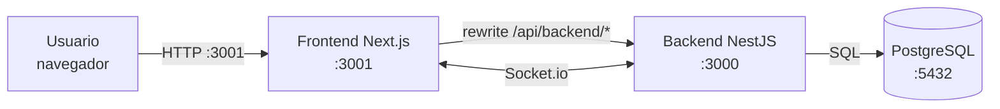

<p align="center">
  
</p>

<h1 align="center">RestorApp</h1>

<p align="center">
  <strong>Sistema integral de gestión para restaurantes</strong><br>
  Pedidos · Mesas · Cocina · Caja · Facturación · Inventario · Compras · Reportes
</p>

<p align="center">
  
  
  
  
  
  
  
</p>

---

## ¿Qué es RestorApp?

RestorApp es una aplicación web para operar un restaurante de principio a fin:
desde que el mesero toma el pedido hasta que el cajero cobra, cierra la caja y
consulta los reportes del día.

Está pensada para funcionar en la **red local del restaurante**, con una sola
instalación y acceso desde computadores, tablets o celulares. Incluye
actualizaciones en tiempo real para que cocina, meseros y caja vean el mismo
estado sin recargar la página.

### Lo que puedes hacer

- **Salón:** gestionar mesas, reservas y ocupación.
- **Pedidos:** crear pedidos, agregar líneas, editar, transferir y cancelar.
- **Cocina:** ver la cola de preparación y cambiar el estado de cada ítem.
- **Cobro:** cobrar desde el pedido o desde facturación, con IVA, propina y
  pago mixto.
- **Caja:** abrir y cerrar turnos, registrar entradas/salidas y hacer arqueo.
- **Facturación:** consultar, pagar y anular facturas.
- **Inventario:** controlar stock, recetas, disponibilidad y movimientos.
- **Compras:** proveedores, órdenes de compra y entradas de stock.
- **Reportes:** ventas del día, ventas por rango, productos vendidos, consumo
  de insumos y desempeño por mesero.
- **Usuarios y roles:** Administrador, Mesero, Chef y Cajero, con roles
  operativos por turno.
- **Tiempo real:** pedidos, mesas, facturas y notificaciones sincronizadas.

---

## Stack

| Capa | Tecnología |
|---|---|
| Backend | NestJS 11 + TypeORM |
| Base de datos | PostgreSQL 13+ (recomendado 16) |
| Frontend | Next.js 14 (App Router) + React 18 + TypeScript |
| Estilos | Tailwind CSS + CSS propio |
| Tiempo real | Socket.io 4 |
| Autenticación | JWT RS256 en cookie httpOnly |
| Pruebas | Jest + ts-jest |
| CI | GitHub Actions |
| Contenedores | Docker Compose v2 |

---

## Arquitectura



- El navegador habla con el frontend por el mismo origen.
- Next reescribe `/api/backend/*` hacia el backend.
- La cookie httpOnly viaja automáticamente y autentica la API y el socket.
- En producción se recomienda un proxy inverso para unificar todo en un solo
  origen (ver [`documentacion/10-despliegue-seguro.md`](documentacion/10-despliegue-seguro.md)).

---

## Estructura del repositorio

```text
RESTORAPP/
├── prime-nestjs/          API REST + WebSocket (NestJS)
│   ├── src/
│   │   ├── auth/          Login, JWT, guards
│   │   ├── pedidos/       Pedidos y cobro
│   │   ├── facturas/      Facturas y pagos
│   │   ├── turnos/        Caja y arqueo
│   │   ├── recetas/       Inventario y disponibilidad
│   │   ├── reportes/      Reportes
│   │   ├── realtime/      Gateway Socket.io
│   │   └── ...
│   ├── migrations/        Esquema versionado
│   ├── scripts/           Semillas y utilidades
│   └── test/              Pruebas
├── restorapp-nextjs/      Interfaz web (Next.js)
│   ├── src/app/           Rutas y pantallas
│   ├── src/components/    Componentes
│   ├── src/lib/           API, socket, formatos
│   └── public/            Recursos estáticos
├── documentacion/         Documentación técnica completa
├── deploy/                Ejemplos de proxy y despliegue
├── assets/                Logo y recursos compartidos
├── LICENSE                Licencia propietaria
├── LICENSE-MIT            Licencia del backend base
└── THIRD_PARTY_NOTICES.md Avisos de terceros
```

---

## Puesta en marcha

### Requisitos

- Node.js **20 o superior** (verificado con 22).
- npm 10 o superior.
- Docker y Docker Compose v2 (recomendado para PostgreSQL).
- PostgreSQL 13+ si no usas Docker.

### 1. Clonar

```bash
git clone https://github.com/dsrojasal/RestorAppV1.git
cd RestorAppV1
```

### 2. Backend

```bash
cd prime-nestjs

# Dependencias (sin ejecutar scripts de instalación)
npm ci --ignore-scripts

# Configuración
cp .env.example .env
# Edita .env con tu base de datos y tus claves RSA

# Base de datos
docker compose up -d database

# Migraciones
npm run migration:run

# Desarrollo
npm run start:dev
```

La API queda en `http://localhost:3000` y Swagger en
`http://localhost:3000/api` (solo en desarrollo).

### 3. Frontend

```bash
cd ../restorapp-nextjs

npm ci --ignore-scripts
cp .env.example .env
# Ajusta API_URL y las variables del socket si hace falta

npm run dev
```

La interfaz queda en `http://localhost:3001`.

> Si vas a compilar para producción, detén primero `next dev`. En Next 14
> ambos comparten `.next` y pueden romperse entre sí.

### Variables de entorno

No hay secretos en este repositorio. Las plantillas están en:

- `prime-nestjs/.env.example`
- `restorapp-nextjs/.env.example`

La referencia completa está en
[`documentacion/09-configuracion-entornos.md`](documentacion/09-configuracion-entornos.md).

El backend necesita un par de claves RSA (`PRIVATE_KEY` y `PUBLIC_KEY`). Sin
ellas no arranca. El documento 09 explica cómo generarlas.

---

## Calidad y pruebas

| Comprobación | Estado |
|---|---|
| Pruebas unitarias backend | 25/25 en verde |
| Lint backend | Sin errores |
| Build backend | Correcto |
| Lint frontend | Sin errores (advertencias documentadas) |
| Build frontend | Correcto (19 rutas) |
| CI | GitHub Actions en push/PR a `main` |

Comandos:

```bash
# Backend
cd prime-nestjs
npm test -- --runInBand
npx eslint "{src,test}/**/*.ts"
npm run build

# Frontend
cd ../restorapp-nextjs
npx next lint
npm run build
```

El detalle está en
[`documentacion/13-pruebas-y-calidad.md`](documentacion/13-pruebas-y-calidad.md).

---

## Documentación

Toda la documentación técnica está en [`documentacion/`](documentacion/README.md).

| Documento | Para qué sirve |
|---|---|
| [Arquitectura](documentacion/01-arquitectura-general.md) | Cómo está armado el sistema |
| [Backend](documentacion/02-backend.md) | Módulos, guards, transacciones y eventos |
| [Frontend](documentacion/03-frontend.md) | Rutas, sesión y tiempo real |
| [Base de datos](documentacion/04-base-de-datos.md) | Tablas, relaciones e índices |
| [API](documentacion/05-api-referencia.md) | Todos los endpoints y permisos |
| [Permisos](documentacion/06-permisos-y-roles.md) | Qué puede hacer cada rol |
| [Flujos](documentacion/07-flujos-de-negocio.md) | Pedido, cocina, cobro, caja e inventario |
| [Tiempo real](documentacion/08-tiempo-real-socket.md) | Eventos y salas |
| [Entornos](documentacion/09-configuracion-entornos.md) | Variables y perfiles |
| [Despliegue](documentacion/10-despliegue-seguro.md) | Instalación, proxy y HTTPS |
| [Operación](documentacion/11-operacion-y-mantenimiento.md) | Logs, respaldos y diagnóstico |
| [Seguridad](documentacion/12-seguridad.md) | Controles y riesgos pendientes |
| [Pruebas](documentacion/13-pruebas-y-calidad.md) | Tests, lint y builds |
| [Licencia y créditos](documentacion/14-licencia-y-creditos.md) | Modelo legal y atribuciones |

---

## Estado del proyecto

| Aspecto | Estado |
|---|---|
| Operación en red local | Funcional y probada |
| Tiempo real | Verificado en localhost y LAN |
| Base de datos | Esquema versionado con migraciones |
| Facturación electrónica DIAN | **No implementada** |
| HTTPS | No configurado por defecto |
| Cuentas demo | Activas; se pueden desactivar antes de producción |
| Actualización a Next 16 | Pendiente (corrige vulnerabilidades) |

Antes de publicar el sistema fuera de la red local, revisa
[`documentacion/12-seguridad.md`](documentacion/12-seguridad.md) y
[`documentacion/10-despliegue-seguro.md`](documentacion/10-despliegue-seguro.md).

---

## Licencia

**RestorApp es software propietario.** © 2026 Daniel Rojas. Todos los derechos
reservados.

El backend se construyó a partir de **prime-nestjs** de Joseph Goksu, que se
distribuye bajo licencia **MIT**. Esa porción conserva su licencia original.

- [`LICENSE`](LICENSE) — licencia propietaria de RestorApp.
- [`LICENSE-MIT`](LICENSE-MIT) — licencia MIT del backend base.
- [`THIRD_PARTY_NOTICES.md`](THIRD_PARTY_NOTICES.md) — alcance y obligaciones.

El frontend `restorapp-nextjs/` es desarrollo original y **no** deriva de
prime-nestjs.

Para permisos comerciales o de distribución, contacta al titular.

---

## Créditos

- **Backend base:** [prime-nestjs](https://github.com/josephgoksu/prime-nestjs)
  de Joseph Goksu, licencia MIT (2021).
- **RestorApp:** diseño, desarrollo, reglas de negocio, frontend y documentación
  por Daniel Rojas.

---

<p align="center">
  Hecho para que un restaurante trabaje mejor.
</p>
