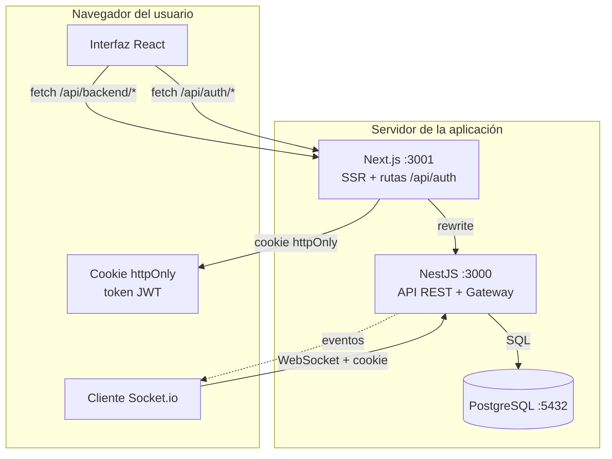
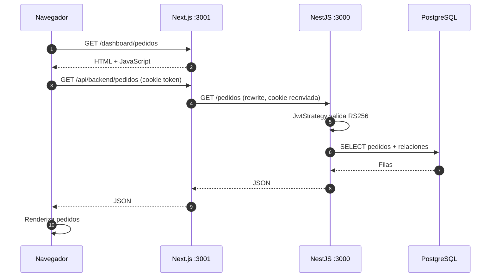
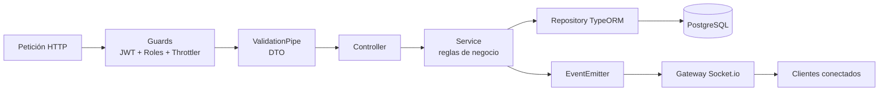

# 01 · Arquitectura general

## 1. Visión de conjunto

RestorApp es una aplicación web de tres capas:

1. **Frontend (Next.js 14)** — interfaz de usuario. Corre en el puerto `3001`.
2. **Backend (NestJS 11)** — API REST + WebSocket. Corre en el puerto `3000`.
3. **Base de datos (PostgreSQL)** — persistencia. Corre en el puerto `5432`.



## 2. Componentes y responsabilidades

### Frontend

- Renderiza las pantallas del restaurante.
- Mantiene la sesión **solo** mediante la cookie `token` (httpOnly).
- Reenvía las llamadas del navegador a la API a través de `rewrites` de Next:
  `/api/backend/*` → `${API_URL}/*`.
- Expone dos rutas propias para crear y borrar la cookie:
  - `POST /api/auth/login`
  - `POST /api/auth/logout`
- Mantiene la conexión Socket.io y refresca los datos al recibir eventos.

### Backend

- Expone la API REST bajo rutas como `/pedidos`, `/facturas`, `/turnos`.
- Autentica cada petición con el JWT de la cookie o de `Authorization`.
- Aplica roles y reglas de negocio en servicios, dentro de transacciones.
- Emite eventos internos (`pedidos.changed`, `mesas.changed`,
  `facturas.changed`, `notificacion.nueva`).
- El gateway Socket.io los retransmite a los navegadores conectados.
- Ejecuta tareas programadas (stock bajo y pedidos abandonados).

### Base de datos

- Guarda todo el estado del negocio.
- El esquema se administra **solo con migraciones** (`synchronize: false`).
- Restricciones e índices protegen la integridad (por ejemplo, un único turno
  abierto a la vez).

## 3. Puertos y URLs

| Servicio | Desarrollo | Producción con proxy |
|---|---|---|
| Frontend | `http://localhost:3001` | `http://IP-DEL-SERVIDOR/` |
| Backend | `http://localhost:3000` | `http://127.0.0.1:3000` (oculto) |
| PostgreSQL | `localhost:5432` | `127.0.0.1:5432` (oculto) |
| Swagger | `http://localhost:3000/api` | Desactivado en producción |
| Salud | `http://localhost:3000/health-check` | `/api/backend/health-check` |

## 4. Flujo completo de una petición

Ejemplo: el mesero abre la pantalla de Pedidos.



Puntos clave:

- El navegador **nunca** conoce la IP del backend: llama al mismo origen.
- La cookie viaja automáticamente en peticiones al mismo origen.
- El backend valida el token en cada petición, no solo al iniciar sesión.

## 5. Modos de ejecución

### Desarrollo

```bash
cd prime-nestjs && npm run start:dev    # :3000 con recarga automática
cd restorapp-nextjs && npm run dev      # :3001 con recarga automática
```

- Next compila bajo demanda y no minifica.
- React StrictMode ejecuta los efectos dos veces (más llamadas API).
- Swagger está disponible en `http://localhost:3000/api`.
- El socket usa el host de la página y el puerto configurado.

### Producción (red local)

```bash
cd prime-nestjs && npm run build && npm run start:prod
cd restorapp-nextjs && npm run build && npm run start
```

- Código minificado y compilado una sola vez.
- Swagger desactivado con `NODE_ENV=production`.
- Backend escuchando en `127.0.0.1` (solo el proxy lo alcanza).
- Proxy de un solo origen (ver documento 10).

## 6. Decisiones de arquitectura

| Decisión | Motivo |
|---|---|
| **JWT RS256** (clave privada/pública) | El backend firma y verifica sin compartir el secreto con el frontend. |
| **Cookie httpOnly** | El JavaScript no puede leer el token; reduce robo por XSS. |
| **Un solo origen con proxy** | Elimina CORS, unifica cookie y socket, oculta el backend. |
| **`synchronize: false`** | Evita que TypeORM altere tablas o borre datos por accidente. |
| **Migraciones versionadas** | Cada cambio de esquema queda registrado y es reproducible. |
| **Transacciones + bloqueo pesimista** | Dos cajas no pueden cobrar la misma factura ni vender el mismo stock. |
| **Eventos internos + debounce** | Varios cambios seguidos generan una sola notificación al navegador. |
| **Paginación opcional** | Compatible con clientes antiguos: sin `page`/`limit` devuelve arreglo. |
| **Host del socket en tiempo de ejecución** | Funciona al cambiar de IP o de máquina sin recompilar. |

## 7. Capas del backend



- **Controller:** recibe, valida parámetros y delega. No tiene reglas de negocio.
- **Service:** transacciones, cálculos, validaciones de estado y permisos finos.
- **Repository:** consultas y persistencia.
- **Interceptor de tiempo real:** al terminar una escritura, emite el evento que
  corresponde según la ruta.

## 8. Comunicación en tiempo real

| Evento | Quién lo recibe | Efecto |
|---|---|---|
| `pedidos.changed` | Todos | Pedidos y mesas se recargan |
| `mesas.changed` | Todos | Mapa de mesas se actualiza |
| `facturas.changed` | Todos | Facturación y caja se actualizan |
| `notificacion.nueva` | Salas por rol o usuario | Aviso en la campana |

El detalle está en `08-tiempo-real-socket.md`.

## 9. Requisitos técnicos

| Requisito | Versión mínima | Verificado con |
|---|---|---|
| Node.js | 18 LTS | 22.21.1 |
| npm | 9 | 10.x |
| PostgreSQL | 13 | 16 (contenedor) |
| Navegador | Chrome/Edge/Firefox actuales | Chromium (Playwright) |

El backend necesita además dos claves RSA (`PRIVATE_KEY` y `PUBLIC_KEY`) en el
`.env`. Sin ellas no arranca.

## 10. Límites conocidos de esta versión

- **No hay facturación electrónica DIAN** (sin CUFE, QR ni nota crédito).
- **No hay multi-sucursal**: una instalación = una base de datos.
- **El bloqueo de login es en memoria**: con varias instancias no se comparte.
- **Una sola caja abierta por base de datos** (restricción única).
- **Sin servicio de arranque automático** por defecto: hay que configurarlo
  (systemd, pm2 o Docker).
