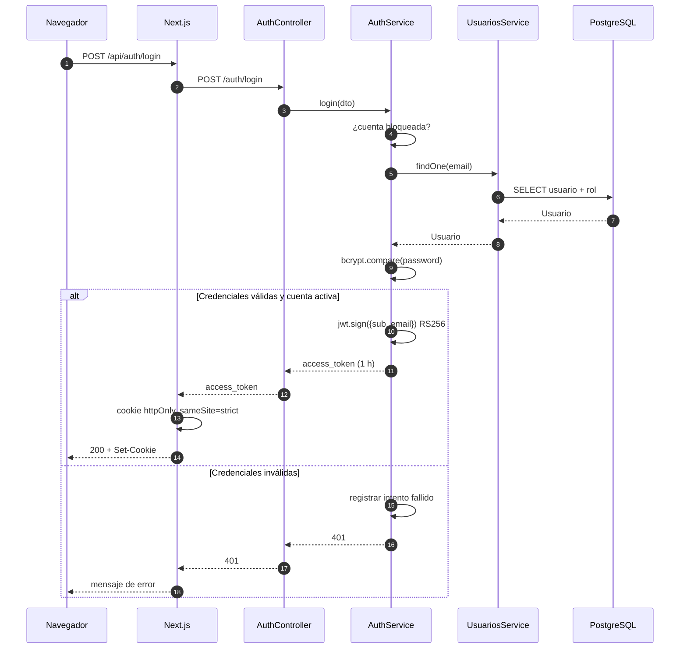

# 02 · Backend (NestJS)

## 1. Estructura del proyecto

```
prime-nestjs/
├── src/
│   ├── main.ts                 Arranque, seguridad global y Swagger
│   ├── app.module.ts           Módulos, guards e interceptor globales
│   ├── config/
│   │   ├── index.ts            Lee variables de entorno
│   │   └── database.ts         Conexión TypeORM y migraciones
│   ├── common/                 Utilidades compartidas (CORS, paginación, filtros)
│   ├── auth/                   Login, JWT, guards y estrategia
│   ├── realtime/               Gateway Socket.io y eventos
│   ├── migrations/             Historial del esquema
│   └── <módulo>/               Un módulo por área del negocio
├── scripts/                    Semillas y utilidades de operación
├── test/                       Pruebas e2e
├── .env                        Configuración real (no se versiona)
└── .env.example                Plantilla de configuración
```

Cada módulo sigue el mismo patrón:

```
<módulo>/
├── <módulo>.module.ts
├── <módulo>.controller.ts
├── <módulo>.service.ts
├── entities/
└── dto/
```

## 2. Arranque (`main.ts`)

El arranque aplica, en este orden:

| Paso | Qué hace | Por qué |
|---|---|---|
| `helmet()` | Cabeceras HTTP seguras | Mitiga XSS, sniffing y clickjacking |
| `trust proxy` | Confía en `X-Forwarded-For` | Rate limiting con la IP real detrás del proxy |
| `enableCors` | Valida orígenes | Permite LAN, rechaza internet |
| `ValidationPipe` | Valida y transforma DTOs | `whitelist`, `forbidNonWhitelisted` |
| `ClassSerializerInterceptor` | Respeta `@Exclude()` | Nunca devuelve `password` |
| `DatabaseExceptionFilter` | Traduce errores SQL | Mensajes claros, sin filtrar SQL |
| `Swagger` | Documenta la API | Solo si `NODE_ENV !== production` |
| `app.listen` | Escucha en `HOST:PORT` | `HOST=127.0.0.1` en producción |

### Validación global

```ts
new ValidationPipe({
  whitelist: true,            // elimina campos no declarados en el DTO
  transform: true,            // convierte "10" a número cuando corresponde
  forbidNonWhitelisted: true, // rechaza campos desconocidos
});
```

Consecuencia práctica: **enviar un campo que el DTO no declara produce 400**.
No se aceptan parámetros "de más".

### CORS

El validador `src/common/cors-origin.ts` se comparte con Socket.io:

- Sin cabecera `Origin` → permitido (curl, apps nativas, servidor).
- Origen listado en `ALLOWED_ORIGINS` → permitido.
- `localhost`, `127.0.0.1`, `::1` → permitidos en cualquier puerto.
- Rangos privados `10/8`, `192.168/16`, `172.16–31/12` → permitidos en cualquier
  puerto.
- Cualquier otro origen → rechazado (sin error 500).

## 3. Módulos del sistema

| Módulo | Responsabilidad |
|---|---|
| `AuthModule` | Login, registro, JWT, estrategia y guards |
| `UsuariosModule` | CRUD de usuarios, activación/desactivación |
| `RolModule` | Roles globales |
| `TipoPagoModule` | Métodos de pago (efectivo, tarjetas, transferencia) |
| `CategoriasModule` | Categorías de la carta |
| `ProductosModule` | Platos, bebidas y postres |
| `IngredientesModule` | Insumos y su stock |
| `ProductoIngredienteModule` | Receta: qué ingrediente lleva cada plato |
| `RecetasModule` | Disponibilidad, reserva y consumo de inventario |
| `MesasModule` | Mesas y su estado |
| `ReservasModule` | Reservas de mesas |
| `PedidosModule` | Creación, líneas, estados y cobro |
| `DetallePedidoModule` | Líneas de pedido (CRUD administrativo) |
| `FacturasModule` | Facturas, pagos mixtos y anulación |
| `TurnosModule` | Apertura/cierre de caja, personal y movimientos |
| `ProveedoresModule` | Proveedores |
| `OrdenesCompraModule` | Órdenes de compra |
| `DetalleOrdenCompraModule` | Líneas de orden de compra |
| `EntradaStockModule` | Entradas de inventario con historial |
| `DashboardModule` | Resumen del día |
| `ReportesModule` | Ventas, productos, insumos y meseros |
| `NotificacionesModule` | Avisos internos y tareas programadas |
| `RealtimeModule` | Gateway Socket.io |
| `LoggerModule` | Logger de Nest |
| `SeedModule` | Roles y métodos de pago iniciales |

## 4. Autenticación y autorización

### 4.1 Inicio de sesión



Reglas del login:

- Contraseñas con **bcrypt** (costo 10) y `@Exclude()` para no serializarlas.
- Token **RS256** firmado con `PRIVATE_KEY`, válido **1 hora**.
- **Bloqueo temporal**: 8 intentos fallidos → 5 minutos de espera (en memoria).
- Límite de **10 intentos por minuto** por IP (`@Throttle`).
- Cuenta desactivada: se rechaza aunque la contraseña sea correcta.

### 4.2 Cómo viaja el token

El backend acepta el token de dos formas:

1. **Cookie `token`** (la que usa el navegador).
2. **`Authorization: Bearer <token>`** (integraciones y pruebas).

La estrategia `JwtStrategy` verifica la firma con `PUBLIC_KEY`, comprueba la
expiración y vuelve a cargar el usuario desde la base. Si el usuario fue
desactivado, el token deja de servir inmediatamente.

> Importante: la cookie es `httpOnly`, así que **JavaScript no puede leerla**.
> Las peticiones funcionan por el envío automático de cookies al mismo origen,
> no por un header `Authorization` construido en el cliente.

### 4.3 Guards globales

En `app.module.ts` se registran:

- `JwtAuthGuard` → toda ruta requiere sesión salvo las marcadas `@Public()`.
- `ThrottlerGuard` → 100 peticiones por minuto por IP.
- `RealtimeInterceptor` → emite eventos al terminar escrituras.

Rutas públicas:

- `GET /`
- `GET /health-check`
- `POST /auth/login`

Todo lo demás exige token válido.

### 4.4 Roles

```ts
@Roles(Role.ADMIN, Role.CAJERO)
@UseGuards(RolesGuard)
```

`RolesGuard` lee los roles declarados y compara con `user.rol.nombre`. Si la
ruta no declara `@Roles`, basta con estar autenticado.

Además de los roles, los servicios aplican **reglas de propiedad**:

- Un mesero solo modifica **sus** pedidos.
- Un cajero puede cobrar pedidos de otros (parámetro `permitirCajero`).
- El administrador no tiene restricción de propiedad.

## 5. Validación y DTOs

- `class-validator` + `class-transformer`.
- Ejemplo real (`CreateUsuarioDto`): email válido, nombre ≤ 100, contraseña
  entre 8 y 72 caracteres, rol opcional.
- Ejemplo real (`CobrarPedidoDto`): `modo` solo acepta `"caja"` o `"propio"`;
  porcentajes entre 0 y 100; pagos con `monto > 0`.

## 6. Errores

`DatabaseExceptionFilter` traduce errores de PostgreSQL:

| Código | Significado | Respuesta |
|---|---|---|
| `23505` | Registro duplicado | 409 con mensaje por tabla |
| `23503` | Violación de clave foránea | 409 ("tiene información asociada") |
| `23502` | Falta un campo obligatorio | 400 |
| `22P02` | Dato inválido | 400 |
| `22003` | Número fuera de rango | 400 |
| `22001` | Texto demasiado largo | 400 |
| `23514` | Regla de la base | 400 |

Cualquier error no controlado se registra completo en el servidor y al cliente
se le devuelve un mensaje genérico. **Nunca se filtra SQL ni el stack trace.**

## 7. Transacciones y concurrencia

Los flujos críticos usan `dataSource.transaction`:

| Operación | Protección |
|---|---|
| Crear pedido | `UPDATE mesa ... WHERE estado = 'libre'` atómico |
| Cobrar pedido | `pessimistic_write` sobre el pedido |
| Pagar factura | `pessimistic_write` sobre la factura |
| Abrir turno | Índice único parcial `UQ_TURNO_ABIERTO` |
| Cerrar turno | `pessimistic_write` sobre el turno |
| Reservar stock | Bloqueo de ingredientes/productos y validación de disponible |

Resultado: dos cajas no pueden cobrar la misma cuenta ni vender el mismo stock
al mismo tiempo.

## 8. Cálculo de dinero

- Se usa `decimal.js` para sumas, IVA, propina y aritmética de stock.
- Redondeo a 2 decimales con `ROUND_HALF_UP`.
- El stock usa 3 decimales (`precision: 14, scale: 3`).
- Reglas del cobro:
  - IVA = subtotal × %IVA.
  - Propina = subtotal × %propina, **nunca sobre el IVA**.
  - Total = subtotal + IVA + propina.
  - Si el pago es mixto, la suma debe coincidir con el total (±0.01) y se
    ajusta el primer pago por centavos.

## 9. Paginación

`PaginacionQueryDto` (`page`, `limit`) es **opcional**:

- Sin `page` ni `limit`: devuelve un arreglo (compatibilidad).
- Con `page` o `limit`: devuelve `{ data, total, page, limit, pages }`.
- `limit` máximo: 200. Por defecto: 50.

## 10. Tareas programadas

| Tarea | Frecuencia por defecto | Qué hace |
|---|---|---|
| Inventario bajo | Cada 5 minutos | Notifica insumos/productos bajo el mínimo |
| Pedidos abandonados | Cada 30 minutos | Avisa pedidos sin actividad por 3 horas |

Se configuran con `NOTIF_INVENTORY_CRON`, `NOTIF_ABANDONADO_CRON` y
`NOTIF_ABANDONADO_HORAS`.

## 11. Eventos internos

| Evento | Se emite cuando | Lo consume |
|---|---|---|
| `pedidos.changed` | Se crea/edita/cobra un pedido | Gateway |
| `mesas.changed` | Cambia una mesa o un pedido | Gateway |
| `facturas.changed` | Se paga/anula una factura | Gateway |
| `notificacion.nueva` | Se crea una notificación | Gateway |

El `RealtimeInterceptor` decide el evento según la ruta HTTP; el gateway aplica
un **debounce de 250 ms** para no saturar.

## 12. Swagger

- Disponible en `http://localhost:3000/api` cuando `NODE_ENV !== "production"`.
- En producción **no se registra**, por seguridad.
- Requiere `addBearerAuth()` para probar rutas protegidas.

## 13. Scripts útiles

| Script | Qué hace |
|---|---|
| `npm run start:dev` | Desarrollo con recarga |
| `npm run build` | Compila a `dist/` |
| `npm run start:prod` | Ejecuta `dist/main` |
| `npm run lint` | ESLint con autofix |
| `npm test` | Pruebas unitarias |
| `npm run migration:run` | Aplica migraciones pendientes |
| `npm run migration:generate` | Genera migración por diferencias |
| `npm run migration:revert` | Revierte la última migración |
| `npm run seed:carta` | Carga carta de ejemplo |
| `npm run seed:usuarios-demo` | Crea usuarios demo |
| `npm run security:audit` | `npm audit` |
| `npm run security:demo-off` | Desactiva cuentas demo |

## 14. Reglas para modificar el backend

1. No cambiar `synchronize` a `true`.
2. Todo cambio de entidad requiere **migración**.
3. No devolver entidades con datos sensibles sin `@Exclude()`.
4. Las reglas de negocio van en el **service**, no en el controller.
5. Cualquier escritura nueva debe pasar por `DatabaseExceptionFilter`.
6. Si una ruta escribe datos, revisar si debe emitir evento de tiempo real.
