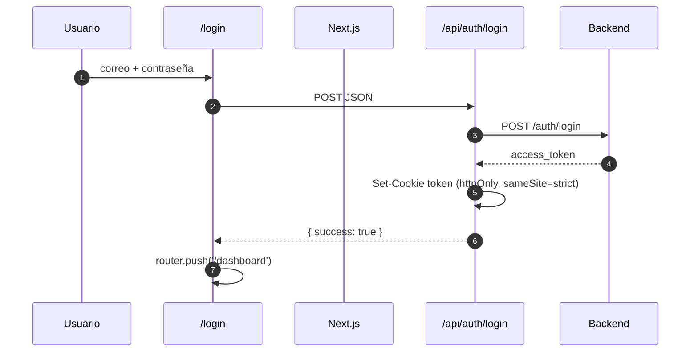

# 03 · Frontend (Next.js)

## 1. Estructura

```
restorapp-nextjs/
├── src/
│   ├── app/
│   │   ├── layout.tsx          Layout raíz (fuentes, metadatos)
│   │   ├── page.tsx            Redirige a /login
│   │   ├── login/page.tsx      Pantalla de acceso
│   │   ├── api/auth/           Login y logout (crean/borran la cookie)
│   │   └── dashboard/          Todas las pantallas internas
│   ├── components/             Componentes reutilizables
│   ├── lib/                    API, socket, formatos, utilidades
│   └── middleware.ts           Protección de /dashboard
├── next.config.js              Rewrite /api/backend → backend
├── .env                        Configuración real
└── .env.example                Plantilla
```

Es una aplicación **de cliente**: todas las páginas del dashboard llevan
`'use client'` y consumen la API por `fetch`.

## 2. Rutas del frontend

| Ruta | Pantalla | Qué hace |
|---|---|---|
| `/` | — | Redirige a `/login` |
| `/login` | Acceso | Formulario de correo y contraseña |
| `/dashboard` | Dashboard | Ventas del día, mesas, pedidos y alertas |
| `/dashboard/carta` | Carta | Platos, categorías, ingredientes y recetas |
| `/dashboard/mesas` | Mesas | Mapa de mesas y cambio de estado |
| `/dashboard/cocina` | Cocina | Cola de preparación en vivo |
| `/dashboard/pedidos` | Pedidos | Crear pedidos, agregar líneas, entregar y cobrar |
| `/dashboard/facturacion` | Facturación | Cobrar cuentas pendientes, pago mixto, anular |
| `/dashboard/caja` | Caja | Abrir/cerrar turno, movimientos e historial |
| `/dashboard/caja/cierre/[id]` | Cierre de caja | Detalle del arqueo de un turno cerrado |
| `/dashboard/inventario` | Inventario | Stock, recetas, entradas y movimientos |
| `/dashboard/proveedores` | Proveedores | Alta y edición de proveedores |
| `/dashboard/usuarios` | Usuarios | Alta, edición y activación de usuarios |
| `/dashboard/reportes` | Reportes | Lista de reportes disponibles |
| `/dashboard/reportes/[id]` | Reporte | Visualización, PDF y CSV |
| `/dashboard/configuracion` | Configuración | Ajustes de la aplicación |

Rutas propias de Next (no del backend):

| Ruta | Método | Función |
|---|---|---|
| `/api/auth/login` | POST | Llama a `POST /auth/login` y guarda la cookie |
| `/api/auth/logout` | POST | Borra las cookies `token` y `user` |

## 3. Sesión y protección de rutas



- `middleware.ts` intercepta `/dashboard/**`.
- Si **no hay cookie `token`**, redirige a `/login?redirect=...`.
- Si hay token y se visita `/login`, redirige a `/dashboard`.
- El layout del dashboard consulta `/api/backend/usuarios/me`:
  - `200` → carga nombre, correo y rol.
  - `401` → borra la cookie y envía a `/login?expired=1`.

> El middleware solo comprueba que la cookie exista. La validación real de la
> firma y la vigencia la hace el backend en cada petición.

## 4. Cómo se llama a la API

Todas las llamadas del navegador usan **el mismo origen**:

```ts
fetch('/api/backend/pedidos', { headers: getAuthHeaders() });
```

`next.config.js` reescribe la ruta:

```js
source: '/api/backend/:path*'
destination: `${process.env.API_URL || 'http://localhost:3000'}/:path*`
```

Ventajas:

- El navegador no necesita CORS.
- La cookie httpOnly viaja automáticamente.
- Cambiar de máquina o de IP no requiere recompilar el frontend.

### `lib/api.ts`

| Función | Uso |
|---|---|
| `getAuthHeaders()` | Devuelve `Content-Type` y, si puede leer el token, `Authorization` |
| `handleApiError(res)` | Extrae el mensaje del backend y el status |
| `normalizarMensaje()` | Une mensajes de validación en un texto legible |

> Como la cookie es httpOnly, `getAuthHeaders()` normalmente **no** incluye
> `Authorization`; la autenticación ocurre por la cookie enviada por el
> navegador. `apiFetch()` existe pero no se usa en las pantallas actuales.

## 5. Componentes principales

| Componente | Función |
|---|---|
| `Sidebar` | Navegación filtrada por rol y estado de caja |
| `Topbar` | Menú, notificaciones y perfil |
| `NotificationPanel` | Bandeja de notificaciones |
| `ProfileCard` | Datos del usuario y cierre de sesión |
| `LiveIndicator` | Estado de la conexión en vivo |
| `ModalSheet` | Ventana modal reutilizable |
| `MoneyInput` | Entrada de montos con formato |
| `CobroForm` | Formulario de cobro: IVA, propina y pago mixto |
| `TicketModal` | Vista previa e impresión del ticket |
| `ContextMenu` | Menú contextual de acciones |
| `ResumenVentasCard` | Tarjeta de ventas del dashboard |
| `Carta/*` | Pestañas de platos, categorías, ingredientes y recetas |

## 6. Librerías internas (`src/lib`)

| Archivo | Responsabilidad |
|---|---|
| `api.ts` | Headers, errores y normalización de mensajes |
| `auth.ts` | Verificación de JWT con `jose` (utilidad) |
| `socket.ts` | Conexión Socket.io con host en tiempo de ejecución |
| `useLiveData.ts` | Suscripción a eventos + sondeo de respaldo |
| `useNotifications.ts` | Notificaciones en vivo y marcado de leídas |
| `montos.ts` | Formato y parseo de dinero |
| `unidades.ts` | Formato y parseo de cantidades con unidad |
| `reportes.ts` | Fechas, CSV y formatos de reportes |
| `tiempo.ts` | Utilidades de tiempo |
| `imprimirTicket.ts` | Generación e impresión del ticket |

### `useLiveData`

```ts
useLiveData(['pedidos.changed', 'mesas.changed'], cargar);
```

- Ejecuta `cargar()` cuando llega cualquiera de esos eventos.
- También cada 60 segundos como respaldo (por si el socket cae).
- Devuelve `connected` para mostrar u ocultar el aviso de conexión.

### `useNotifications`

- Carga `/api/backend/notificaciones`.
- Escucha `notificacion.nueva` y actualiza el contador.
- Al reconectar, vuelve a pedir la lista.
- Marca leída de forma optimista y luego confirma con el backend.

## 7. Menú por rol

El `Sidebar` filtra los accesos según el rol global y los roles del turno.

| Rol global | Accesos |
|---|---|
| Administrador (1) | Todos |
| Mesero (2) | Dashboard, Mesas, Pedidos |
| Chef (3) | Cocina |
| Cajero (4) | Dashboard, Facturación, Caja, Reportes |

Los roles de turno (`mesero`, `cajero`, `cocinero`) **suman** accesos al rol
global. Por ejemplo, un Mesero asignado como `cajero` en el turno también ve
Facturación, Caja y Reportes.

> Esto es solo la visibilidad del menú. La autorización real la aplica el
> backend con `@Roles` y reglas de propiedad.

## 8. Estados de la interfaz

- **Cargando:** cada pantalla muestra su propio estado mientras llegan los datos.
- **Sin conexión en vivo:** `LiveIndicator` avisa si el socket se desconectó;
  los datos se siguen refrescando por sondeo.
- **Errores:** se muestra el mensaje normalizado del backend.
- **Optimista:** marcar notificaciones como leídas se refleja de inmediato.

## 9. Rendimiento

Mediciones reales en modo desarrollo:

| Métrica | Desarrollo | Producción |
|---|---|---|
| `main-app.js` | ~1.34 MB | ~31.7 kB |
| Primera carga de `/login` | ~1.78 s | Muy inferior |
| Llamadas API en Pedidos | 24 | ~8 |

Causas de la diferencia:

1. `next dev` compila al navegar y no minifica.
2. React StrictMode ejecuta los efectos dos veces en desarrollo.
3. Las fuentes se cargan desde Google Fonts (dos hojas externas).
4. El backend en `--watch` usa mapas de código.

Recomendaciones:

- Usar `next build` + `next start` en operación real.
- Servir las fuentes localmente (`next/font` o archivos propios).
- Activar compresión en el proxy (Caddy ya la trae en el ejemplo).

## 10. Rendimiento del build

El build de producción genera 19 rutas. Ejemplos de peso:

| Ruta | First Load JS |
|---|---|
| `/login` | ~89 kB |
| `/dashboard/pedidos` | ~114 kB |
| `/dashboard/facturacion` | ~122 kB |
| `/dashboard/carta` | ~96.9 kB |

## 11. Variables del frontend

| Variable | Uso |
|---|---|
| `API_URL` | URL interna que usa Next para el rewrite |
| `NEXT_PUBLIC_API_URL` | URL base del socket (solo protocolo y puerto) |
| `NEXT_PUBLIC_SOCKET_SAME_ORIGIN` | `true` para usar el mismo origen |
| `COOKIE_SECURE` | `true` solo con HTTPS |

Detalle completo en `09-configuracion-entornos.md`.

## 12. Reglas para modificar el frontend

1. No guardar tokens ni contraseñas en `localStorage`.
2. No llamar al backend por IP fija: usar `/api/backend/*`.
3. No duplicar reglas de negocio; el backend es la autoridad.
4. Mantener el filtrado de menú alineado con `@Roles` del backend.
5. Probar los tres accesos: `localhost`, `127.0.0.1` y la IP de la LAN.
6. No ejecutar `next build` con `next dev` encendido (comparten `.next` en
   Next 14 y provoca 404 de estilos).
