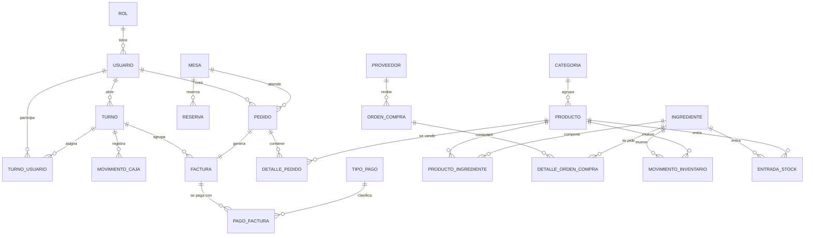
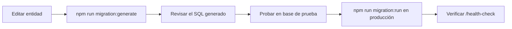

# 04 · Base de datos

## 1. Motor y configuración

| Parámetro | Valor |
|---|---|
| Motor | PostgreSQL |
| Base por defecto | `postgres` |
| Driver | TypeORM (`pg`) |
| `synchronize` | **`false`** (el esquema solo cambia por migraciones) |
| Pool | 10 conexiones por defecto (`POSTGRES_POOL_SIZE`) |
| Timeout de conexión | 5 000 ms |
| Zona horaria de negocio | `America/Bogota` |
| Tipos monetarios | `decimal(12,2)` / `decimal(10,2)` |
| Tipos de stock | `decimal(14,3)` |

`synchronize: false` es una decisión de seguridad: TypeORM **no** altera ni
borra tablas automáticamente al arrancar.

## 2. Diagrama entidad-relación (principal)



## 3. Tablas

### 3.1 Seguridad y usuarios

| Tabla | Columnas principales | Notas |
|---|---|---|
| `rol` | `id`, `nombre` (único), `descripcion` | 4 roles sembrados |
| `usuario` | `id`, `name`, `email` (único), `password` (hash), `isActive`, `rolId`, `createdAt`, `updatedAt` | `password` con `@Exclude()` |

### 3.2 Operación del salón

| Tabla | Columnas principales | Notas |
|---|---|---|
| `mesa` | `id`, `numero` (único), `capacidad`, `estado`, `descripcion` | Estado: libre, ocupada, reservada, mantenimiento |
| `reserva` | `id`, `mesaId`, `usuarioId`, `nombreCliente`, `fecha`, `horaInicio`, `horaFin`, `numPersonas`, `estado`, `observaciones` | Estado: pendiente, confirmada, cancelada, completada |
| `pedido` | `id`, `mesaId`, `usuarioId`, `tipoPagoId`, `estado`, `total`, `observaciones`, `createdAt`, `updatedAt` | Estado: pendiente, en_preparacion, listo, entregado, cancelado |
| `detalle_pedido` | `id`, `pedidoId`, `productoId`, `cantidad`, `precioUnitario`, `subtotal`, `estado`, `observacion`, `updatedAt` | Mismo enum de estado que el pedido |

### 3.3 Carta e inventario

| Tabla | Columnas principales | Notas |
|---|---|---|
| `categoria` | `id`, `nombre` (único), `descripcion`, `isActive` | |
| `producto` | `id`, `nombre`, `precio`, `tipo`, `stock`, `stockReservado`, `stockMinimo`, `stockMinimoUnidad`, `isActive`, `categoriaId` | Tipo: plato, bebida, postre, otro |
| `ingrediente` | `id`, `nombre` (único), `stock`, `stockReservado`, `stockMinimo`, `stockMinimoUnidad`, `unidad` | Stock con 3 decimales |
| `producto_ingrediente` | `id`, `productoId`, `ingredienteId`, `cantidad` | Único por producto+ingrediente |
| `movimiento_inventario` | `id`, `pedidoId`, `pedidoLineaId`, `ingredienteId`, `productoId`, `tipo`, `cantidad`, `usuarioId`, `createdAt` | Tipo: reserva, liberacion, consumo, reabastecimiento, ajuste_manual |
| `entrada_stock` | `id`, `productoId`, `ingredienteId`, `stockAntes`, `cantidad`, `stockDespues`, `usuarioId`, `fecha` | Historial de entradas |

### 3.4 Caja y facturación

| Tabla | Columnas principales | Notas |
|---|---|---|
| `turno` | `id`, `estado`, `montoInicial`, `montoEsperado`, `montoContado`, `diferencia`, `totalVentas`, `ventasEfectivo`, `totalEntradas`, `totalSalidas`, `totalIva`, `totalPropina`, `cantidadFacturas`, `resumenPagos` (jsonb), `resumenMeseros` (jsonb), `motivoDiferencia`, `abiertoPorId`, `cerradoPorId`, `notas`, `fechaApertura`, `fechaCierre` | Solo uno `abierto` a la vez |
| `turno_usuario` | `id`, `turnoId`, `usuarioId`, `rolTurno` | Único por turno+usuario+rol |
| `movimiento_caja` | `id`, `turnoId`, `tipo`, `monto`, `motivo`, `usuarioId`, `reversoDeId`, `fecha` | No se edita: se revierte con otro movimiento |
| `tipo_pago` | `id`, `nombre` (único) | Efectivo, débito, crédito, transferencia |
| `factura` | `id`, `pedidoId` (único), `subtotal`, `ivaPorcentaje`, `iva`, `propinaPorcentaje`, `propina`, `total`, `estadoPago`, `tipoPagoId`, `creadoPorId`, `cobradoPorId`, `cobradoPorRol`, `fechaCobro`, `turnoId`, `cobradoSinTurno`, `autorizadoSinTurnoPorId`, `motivoSinTurno`, `anuladoPorId`, `motivoAnulacion`, `fechaEmision` | Relación 1:1 con pedido |
| `pago_factura` | `id`, `facturaId`, `tipoPagoId`, `monto`, `fecha`, `cobradoPorId`, `cobradoPorRol`, `createdAt` | Permite pago mixto |

### 3.5 Compras y notificaciones

| Tabla | Columnas principales | Notas |
|---|---|---|
| `proveedor` | `id`, `nombre`, `contacto`, `email` | |
| `orden_compra` | `id`, `proveedorId`, `fecha`, `estado` | Estado: borrador, enviada, recibida, cancelada |
| `detalle_orden_compra` | `id`, `ordenCompraId`, `ingredienteId`, `cantidad`, `precioUnitario`, `subtotal` | |
| `notificaciones` | `id`, `tipo`, `mensaje`, `icono`, `clase`, `refId`, `creadoPorId`, `usuarioId`, `paraAdministrador`, `paraMesero`, `paraChef`, `paraCajero`, `createdAt` | Se emiten por rol o por usuario |
| `notificacion_leida` | `notificacionId`, `usuarioId`, `leidaAt` | Clave compuesta |
| `migrations` | `id`, `timestamp`, `name` | Control de migraciones aplicadas |

### 3.6 Tablas heredadas

| Tabla | Estado |
|---|---|
| `task` | Heredada del proyecto base. **No la usa RestorApp.** |
| `user` | Heredada del proyecto base. **No la usa RestorApp.** |

No las borres sin confirmar que ningún proceso externo las usa.

## 4. Enumeraciones

| Enum | Valores |
|---|---|
| `MesaEstado` | libre, ocupada, reservada, mantenimiento |
| `TipoProducto` | plato, bebida, postre, otro |
| `PedidoEstado` | pendiente, en_preparacion, listo, entregado, cancelado |
| `DetallePedidoEstado` | pendiente, en_preparacion, listo, entregado, cancelado |
| `EstadoPago` | pendiente, pagado, anulado |
| `EstadoTurno` | abierto, cerrado |
| `TipoMovimientoCaja` | entrada, salida |
| `RolTurno` | mesero, cajero, cocinero |
| `OCEstado` | borrador, enviada, recibida, cancelada |
| `ReservaEstado` | pendiente, confirmada, cancelada, completada |
| `TipoMovimientoInventario` | reserva, liberacion, consumo, reabastecimiento, ajuste_manual |

## 5. Índices y restricciones

### Restricciones clave

| Restricción | Tabla | Efecto |
|---|---|---|
| `UQ_TURNO_ABIERTO` (único parcial) | `turno` | Impide dos cajas abiertas a la vez |
| `pedidoId` único | `factura` | Una factura por pedido |
| `email` único | `usuario` | Sin correos duplicados |
| `numero` único | `mesa` | Sin mesas repetidas |
| `productoId + ingredienteId` único | `producto_ingrediente` | Sin ingrediente repetido en una receta |
| `turnoId + usuarioId + rolTurno` único | `turno_usuario` | Sin asignaciones duplicadas |

### Índices de rendimiento

```
IDX_MOVIMIENTO_CAJA_TURNO     (turnoId, fecha)
IDX_TURNO_APERTURA            (fechaApertura)
IDX_TURNO_USUARIO_USUARIO     (usuarioId)
IDX_TURNO_USUARIO_TURNO       (turnoId)
IDX_MOV_INVENTARIO_FECHA      (createdAt)
IDX_MOV_INVENTARIO_INGREDIENTE(ingredienteId)
IDX_MOV_INVENTARIO_PEDIDO     (pedidoId)
IDX_PRODUCTO_INGREDIENTE_INGREDIENTE (ingredienteId)
IDX_DETALLE_PEDIDO_PRODUCTO   (productoId)
IDX_DETALLE_PEDIDO_PEDIDO     (pedidoId)
IDX_PAGO_FACTURA_TIPO         (tipoPagoId)
IDX_PAGO_FACTURA_FACTURA      (facturaId)
IDX_FACTURA_TURNO             (turnoId)
IDX_FACTURA_COBRO             (cobradoPorId, fechaCobro)
IDX_PEDIDO_CREADO             (createdAt)
IDX_PEDIDO_ESTADO             (estado)
IDX_PEDIDO_USUARIO            (usuarioId)
IDX_PEDIDO_MESA               (mesaId)
IDX_NOTIFICACION_CREADO       (createdAt)
IDX_NOTIFICACION_USUARIO      (usuarioId)
IDX_ENTRADA_STOCK_FECHA       (fecha)
IDX_ENTRADA_STOCK_INGREDIENTE (ingredienteId)
IDX_ENTRADA_STOCK_PRODUCTO    (productoId)
```

## 6. Migraciones

### Estado actual

- Migración base: `1793980967798-InitialSchema.ts`
- Ya aplicada como **baseline** en la base real.
- La tabla `migrations` registra lo aplicado.

### Comandos

```bash
cd prime-nestjs

# Aplicar pendientes
npm run migration:run

# Crear una migración a partir de cambios en entidades
npm run migration:generate src/migrations/NombreDelCambio

# Revertir la última
npm run migration:revert
```

### Flujo correcto al cambiar el esquema



Reglas:

1. **Nunca** activar `synchronize`.
2. Revisar el SQL antes de aplicarlo.
3. Probar en una base aparte, nunca en la real.
4. Respaldar antes de migrar en producción.

## 7. Datos iniciales (seed)

Al arrancar, `SeedService` crea si faltan:

**Roles:**

| ID | Nombre |
|---|---|
| 1 | Administrador |
| 2 | Mesero |
| 3 | Chef |
| 4 | Cajero |

**Métodos de pago:**

1. Efectivo
2. Tarjeta débito
3. Tarjeta crédito
4. Transferencia

> Los IDs son importantes: el frontend usa `rolId` 1–4 para el menú.

## 8. Respaldos

### Crear respaldo

```bash
mkdir -p backups
docker exec app_postgres_dev pg_dump -U postgres -d postgres -Fc \
  > backups/restorapp_$(date +%Y%m%d_%H%M).dump
```

### Restaurar

```bash
# Detener backend antes de restaurar
docker exec -i app_postgres_dev pg_restore -U postgres -d postgres --clean --if-exists \
  < backups/restorapp_YYYYMMDD_HHMM.dump
```

### Buenas prácticas

- Respaldar antes de cada migración.
- Guardar una copia fuera del servidor.
- Probar la restauración al menos una vez al mes.
- No usar `--clean` sin respaldo previo.

## 9. Integridad del negocio

| Regla | Dónde se garantiza |
|---|---|
| Una mesa no puede tener dos pedidos abiertos | `UPDATE ... WHERE estado = 'libre'` en transacción |
| Un pedido no se cobra dos veces | `factura.pedidoId` único + bloqueo pesimista |
| Una factura pagada no se anula | Validación en `FacturasService` |
| Solo una caja abierta | Índice único parcial |
| El arqueo con diferencia exige motivo | Validación en `TurnosService` |
| Cobrar sin caja exige administrador y motivo | `TurnosService.validarCobro` |
| El stock reservado no se vende dos veces | Bloqueo y validación en `RecetasService` |
| Los movimientos de caja no se editan | Reverso con movimiento inverso |
