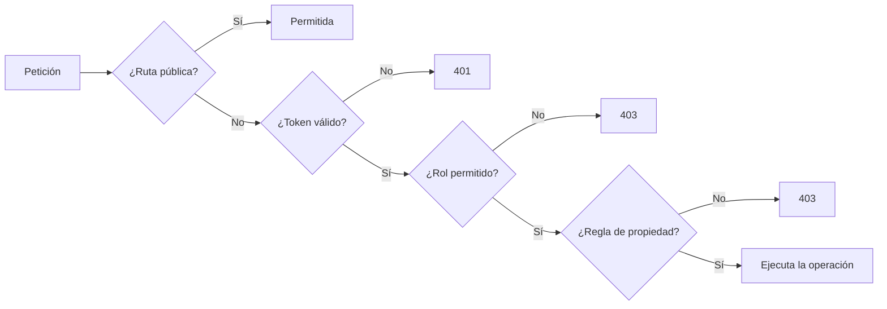

# 06 · Permisos y roles

## 1. Dos sistemas de roles que se combinan

| Sistema | Dónde vive | Para qué sirve |
|---|---|---|
| **Rol global** | `usuario.rolId` → tabla `rol` | Define el puesto: Administrador, Mesero, Chef o Cajero |
| **Rol de turno** | `turno_usuario.rolTurno` | Define qué hace esa persona en la caja abierta: mesero, cajero o cocinero |

Un usuario tiene **un** rol global, pero puede tener **varios** roles de turno.
Ejemplo: un Mesero asignado como `cajero` en el turno puede cobrar y ver la caja
mientras ese turno esté abierto.

## 2. Roles globales

| ID | Rol | Descripción | Alcance |
|---|---|---|---|
| 1 | **Administrador** | Acceso total | Todo el sistema |
| 2 | **Mesero** | Pedidos y mesas | Solo sus pedidos |
| 3 | **Chef** | Cocina | Cambiar estados de preparación |
| 4 | **Cajero** | Cobros y facturas | Facturación y caja |

Los IDs importan: el frontend usa `rolId` 1–4 para decidir el menú visible.

## 3. Roles de turno

| Valor | Nombre | Accesos que suma |
|---|---|---|
| `mesero` | Mesero | Dashboard, Mesas, Pedidos |
| `cajero` | Cajero | Dashboard, Facturación, Caja, Reportes |
| `cocinero` | Cocinero | Cocina |

## 4. Cómo se aplican los permisos



1. **Autenticación** — `JwtAuthGuard` global. Todo requiere token salvo:
   `/`, `/health-check` y `/auth/login`.
2. **Autorización por rol** — `RolesGuard` + `@Roles(...)`.
3. **Reglas de propiedad** — dentro del servicio. Ejemplo: un mesero solo puede
   modificar pedidos donde `pedido.usuarioId === user.id`.

## 5. Matriz de permisos por módulo

Leyenda: **A** = Administrador, **M** = Mesero, **C** = Cajero, **K** = Chef,
**✓** = cualquier usuario autenticado, **P** = público.

| Módulo / acción | A | M | K | C | Otros |
|---|---|---|---|---|---|
| Login | P | P | P | P | P |
| Health check | P | P | P | P | P |
| Registrar usuario (`/auth/register`) | ✓ | — | — | — | — |
| Ver/editar usuarios | ✓ | — | — | — | — |
| Roles | ✓ | — | — | — | — |
| Categorías (ver) | ✓ | ✓ | ✓ | ✓ | ✓ |
| Categorías (crear/editar/borrar) | ✓ | — | — | — | — |
| Productos (ver) | ✓ | ✓ | ✓ | ✓ | ✓ |
| Productos (crear/editar/borrar) | ✓ | — | — | — | — |
| Ingredientes (ver) | ✓ | ✓ | ✓ | ✓ | ✓ |
| Ingredientes (crear/editar/borrar) | ✓ | — | — | — | — |
| Recetas (ver/disponibilidad) | ✓ | ✓ | ✓ | ✓ | ✓ |
| Recetas (editar) | ✓ | — | — | — | — |
| Mesas (ver) | ✓ | ✓ | ✓ | ✓ | ✓ |
| Mesas (crear/editar/borrar) | ✓ | — | — | — | — |
| Reservas (crear/editar) | ✓ | ✓ | — | ✓ | — |
| Pedidos (crear) | ✓ | ✓ | — | ✓ | — |
| Pedidos (ver) | ✓ | ✓ | ✓ | ✓ | ✓ |
| Pedidos (editar/cobrar) | ✓ | ✓* | — | ✓* | — |
| Cambiar estado de línea | ✓ | — | ✓ | — | — |
| Entregar línea | ✓ | ✓* | — | ✓* | ✓* |
| Facturas (ver/pagar/anular) | ✓ | — | — | ✓ | — |
| Facturas (crear/editar/borrar) | ✓ | — | — | — | — |
| Dashboard | ✓ | ✓ | — | ✓ | — |
| Reportes | ✓ | ✓ | — | ✓ | — |
| Abrir/cerrar turno | ✓ | — | — | — | — |
| Asignar personal al turno | ✓ | — | — | — | — |
| Movimientos de caja | ✓ | ✓** | — | ✓** | — |
| Historial de turnos | ✓ | — | — | — | — |
| Proveedores (ver) | ✓ | ✓ | ✓ | ✓ | ✓ |
| Proveedores (editar) | ✓ | — | — | — | — |
| Órdenes de compra (editar) | ✓ | — | — | — | — |
| Entradas de stock | ✓ | — | — | — | — |
| Notificaciones | ✓ | ✓ | ✓ | ✓ | ✓ |
| Swagger | Solo en desarrollo | | | | |

\* Con reglas de propiedad: el mesero solo sus pedidos; el cajero puede cobrar
pedidos de otros, pero no modificarlos.
\*\* El movimiento de caja exige rol de cajero en el turno (o ser administrador).

## 6. Reglas de propiedad en pedidos

`PedidosService.validarDueño`:

| Usuario | ¿Puede modificar un pedido ajeno? |
|---|---|
| Administrador | Sí |
| Mesero | **No** — solo los que él creó |
| Cajero | Solo para cobrar (`permitirCajero = true`) |
| Chef | No modifica pedidos; solo estados de línea |

Mensaje real cuando falla:

```
403 Este pedido lo está atendiendo otro mesero; no puedes modificarlo
```

## 7. Reglas especiales de caja

| Regla | Implementación |
|---|---|
| Solo hay una caja abierta | Índice único parcial + validación |
| Solo el administrador abre/cierra | `@Roles(ADMIN)` |
| Se puede mover efectivo con rol de cajero | `verificarAccesoCaja` |
| Cobrar sin caja abierta | Solo ADMIN + `overrideSinCaja` + motivo ≥ 10 caracteres |
| El arqueo con diferencia exige motivo | `CerrarTurnoDto` |

Si un cajero intenta cobrar sin turno:

```json
{
  "statusCode": 409,
  "code": "CAJA_CERRADA",
  "error": "Caja cerrada",
  "message": "No hay caja abierta. Pídele al administrador que abra el turno."
}
```

## 8. Menú visible en el frontend

| Rol global | Menú |
|---|---|
| Administrador | Dashboard, Carta, Mesas, Cocina, Inventario, Pedidos, Usuarios, Proveedores, Facturación, Caja, Reportes, Configuración |
| Mesero | Dashboard, Mesas, Pedidos |
| Chef | Cocina |
| Cajero | Dashboard, Facturación, Caja, Reportes |

Los roles de turno suman accesos al menú, pero **no cambian el rol global** ni
saltan las validaciones del backend.

> El menú es comodidad visual. La seguridad real está en los guards y en los
> servicios. Ocultar un botón no protege una ruta.

## 9. Cuentas demo

Existen cuentas de demostración para cada rol, creadas con
`npm run seed:usuarios-demo`.

| Aspecto | Estado |
|---|---|
| Contraseña | Débil, pensada para pruebas |
| Recomendación | Desactivarlas antes de producción |
| Comando | `npm run security:demo-off` |

El script las marca como inactivas; **no las borra**, así que se pueden
reactivar si hace falta.

## 10. Cómo agregar un rol nuevo

1. Insertar el rol en `rol` (o ampliar el seed).
2. Actualizar el enum `Role` en `src/common/enums/role.enum.ts`.
3. Añadir `@Roles(...)` en los controladores que correspondan.
4. Actualizar `ROLE_ACCESS` en `Sidebar.tsx` si debe ver nuevas pantallas.
5. Añadir pruebas de los permisos.
6. Documentar la matriz en este archivo.

## 11. Errores de permisos y qué significan

| Respuesta | Significado | Solución |
|---|---|---|
| `401 Unauthorized` | Sin token o token vencido | Volver a iniciar sesión |
| `401 Account is disabled` | Usuario desactivado | Activarlo desde Usuarios |
| `403 Forbidden` | Rol sin permiso o pedido ajeno | Usar la cuenta correcta |
| `409 CAJA_CERRADA` | No hay turno abierto | Abrir caja (administrador) |
| `429` | Demasiados intentos | Esperar el bloqueo temporal |
