# 07 · Flujos de negocio

Este documento explica el recorrido real de las operaciones, con las reglas que
aplica el backend. Es la guía para entender por qué el sistema se comporta como
se comporta.

---

## 1. Ciclo de vida de un pedido

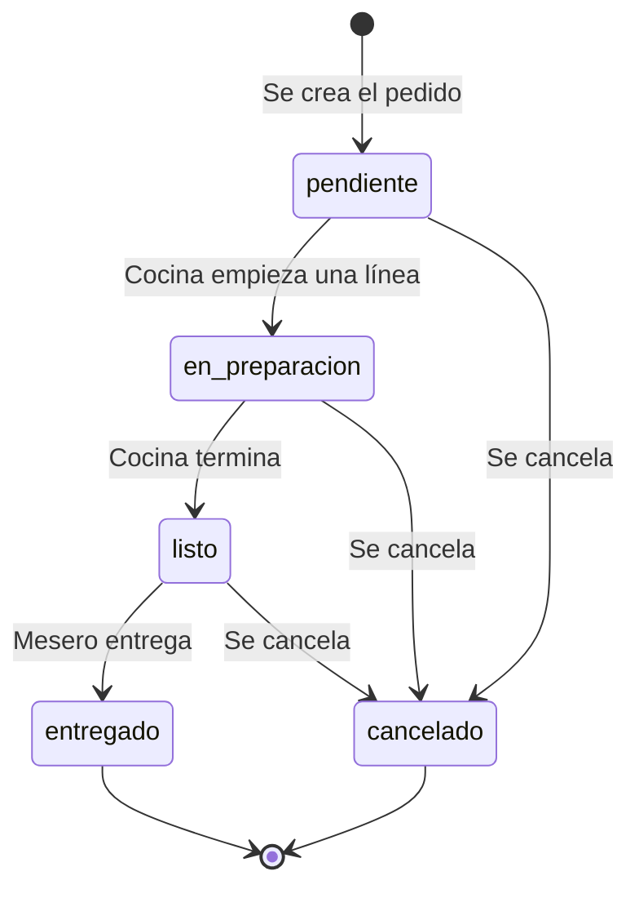

Matices importantes:

- El estado se maneja **por línea**, no solo por pedido.
- Los **platos** nacen en `pendiente`.
- Las **bebidas** nacen directamente en `listo` (no pasan por cocina).
- El estado del pedido se **deriva** de sus líneas:
  - Si alguna línea está `pendiente` o `en_preparacion` → pedido `pendiente`.
  - Si no, y alguna está `listo` → pedido `listo`.
  - Si todas están `entregado` → pedido `entregado`.
- El estado `en_preparacion` existe en el enum del pedido, pero el derivado
  actual no lo usa: cocina trabaja a nivel de línea.

---

## 2. Crear un pedido

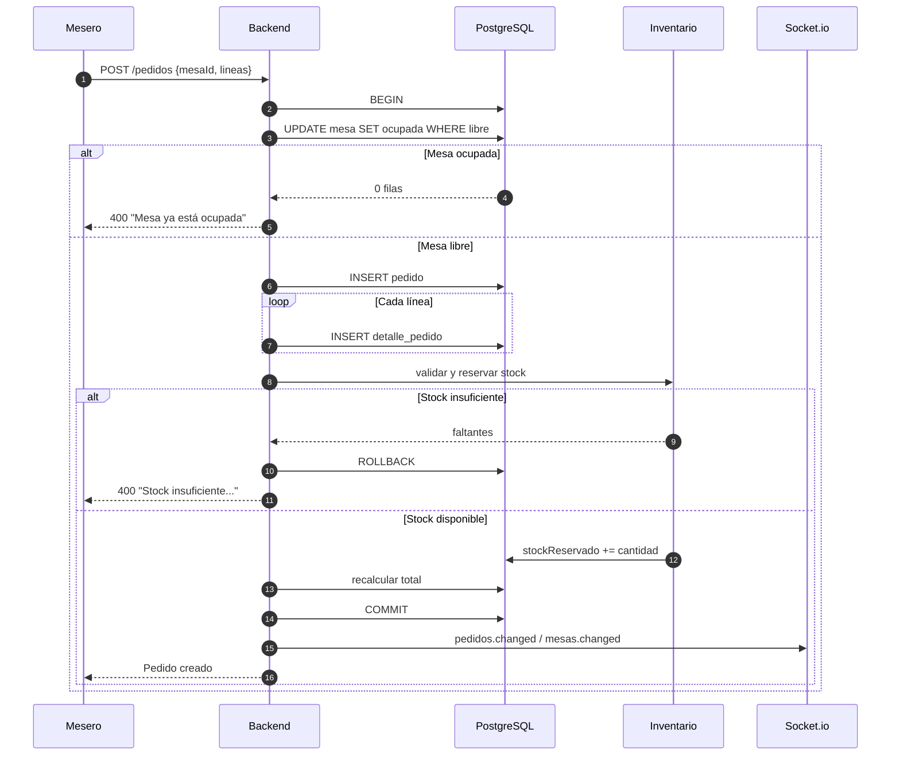

Reglas:

| Regla | Consecuencia |
|---|---|
| La mesa debe estar libre | Si no, no se crea nada |
| El stock se reserva al crear | No se puede sobrevender |
| La operación es atómica | Si falla el stock, tampoco se ocupa la mesa |
| Se notifica al crear | Cocina y meseros ven el pedido |

---

## 3. Cocina

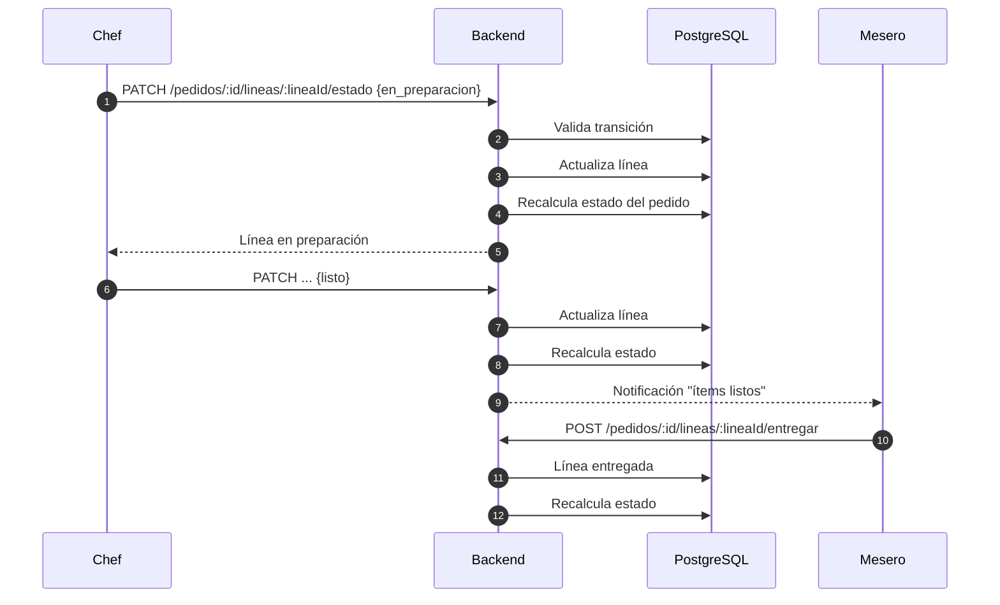

Transiciones permitidas:

| Desde | Hacia |
|---|---|
| `pendiente` | `en_preparacion`, `cancelado` |
| `en_preparacion` | `listo`, `cancelado` |
| `listo` | `cancelado` |
| `entregado` | — (final) |
| `cancelado` | — (final) |

Al cancelar una línea se **libera su reserva de stock**. Al entregar una línea
se **consume** el inventario (se descuenta stock real y reservado).

---

## 4. Cobro

### 4.1 Dos caminos

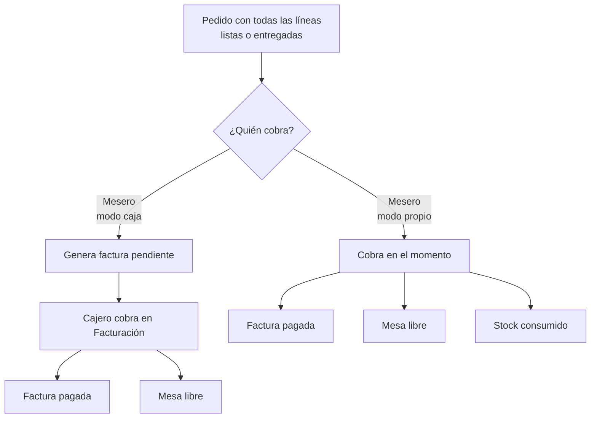

### 4.2 Regla previa: debe existir caja abierta

Antes de cobrar (en cualquiera de los dos caminos) se valida el turno:

- Si hay turno abierto → continúa.
- Si no hay turno:
  - **Administrador** puede continuar solo con `overrideSinCaja: true` y un
    motivo de al menos 10 caracteres.
  - Cualquier otro rol recibe `409 CAJA_CERRADA`.

### 4.3 Cobro propio (mesero)

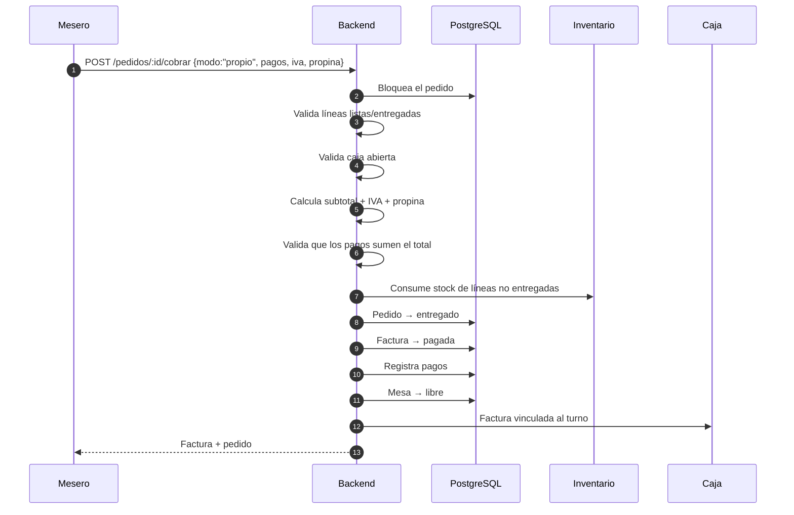

### 4.4 Cobro en caja (cajero)

1. El mesero cobra con `modo: "caja"`.
2. Se crea/actualiza la factura en estado `pendiente`.
3. El pedido queda `entregado`, pero **la mesa sigue ocupada**.
4. El pedido **ya no se puede editar** (hay factura pendiente).
5. El cajero entra a **Facturación** y paga:
   - Se calcula IVA y propina.
   - Se registran los pagos.
   - La factura pasa a `pagada`.
   - La mesa se libera.

### 4.5 Ejemplo numérico

Cuenta con subtotal de 100.000, IVA 19% y propina 10%:

| Concepto | Cálculo | Valor |
|---|---|---|
| Subtotal | — | 100.000,00 |
| IVA | 100.000 × 19% | 19.000,00 |
| Propina | 100.000 × 10% | 10.000,00 |
| **Total** | 100.000 + 19.000 + 10.000 | **129.000,00** |

Pago mixto válido:

```json
[
  { "tipoPagoId": 1, "monto": 80000 },
  { "tipoPagoId": 2, "monto": 49000 }
]
```

Si la suma no coincide: `400 Los pagos suman X y el total de la cuenta es Y`.

> La propina se calcula sobre el **subtotal**, nunca sobre el IVA.
> Si se envía `propinaMonto`, ese valor tiene prioridad sobre el porcentaje.

---

## 5. Caja (turnos)

### 5.1 Apertura

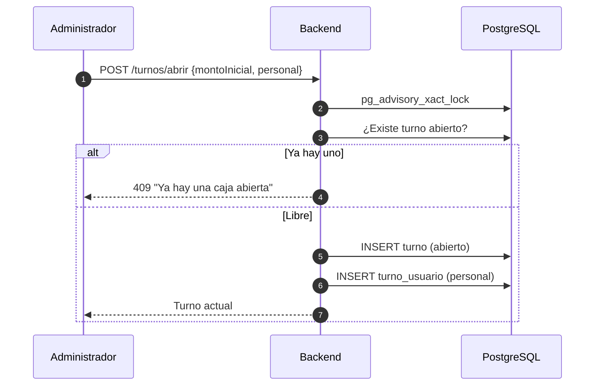

Reglas:

- Solo el administrador abre caja.
- Solo puede haber **una caja abierta** (validación + índice único).
- El personal debe existir y estar activo.
- Un usuario puede tener varios roles en el mismo turno.

### 5.2 Movimientos de efectivo

| Tipo | Efecto en el arqueo |
|---|---|
| `entrada` | Suma al efectivo esperado |
| `salida` | Resta del efectivo esperado |

Reglas:

- Motivo obligatorio (mínimo 5 caracteres).
- Una salida no puede dejar el efectivo disponible en negativo.
- No se edita ni se borra: se revierte con un movimiento del tipo contrario y
  el mismo monto.
- No se permiten movimientos en un turno cerrado.

### 5.3 Cierre y arqueo

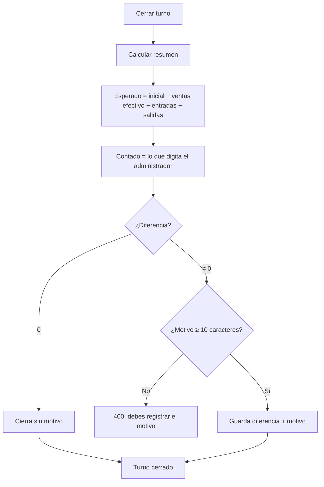

El cierre guarda una **foto** del turno:

- Totales de ventas, efectivo, IVA, propina y número de facturas.
- Desglose por método de pago (`resumenPagos`, jsonb).
- Ventas por mesero (`resumenMeseros`, jsonb).
- Quién abrió y quién cerró.

### 5.4 Cobros sin caja

Si un administrador autorizó un cobro sin turno:

- La factura queda con `cobradoSinTurno = true`.
- Se guarda quién autorizó y el motivo.
- Se consultan en `GET /turnos/cobros-sin-turno`.

---

## 6. Anulación de factura

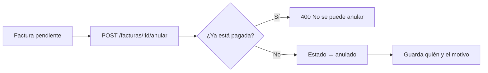

- Solo se anulan facturas **no pagadas**.
- Una factura anulada permite volver a editar el pedido.
- No se borra el registro: queda el historial.

---

## 7. Inventario y recetas

### 7.1 Modelo

- Un **plato** consume ingredientes según su receta.
- Una **bebida** o producto directo consume su propio `stock`.
- Cada recurso tiene:
  - `stock`: existencia física.
  - `stockReservado`: apartado para pedidos abiertos.
  - `stockMinimo`: umbral de alerta.
- Disponible real = `stock − stockReservado`.

### 7.2 Ciclo del stock

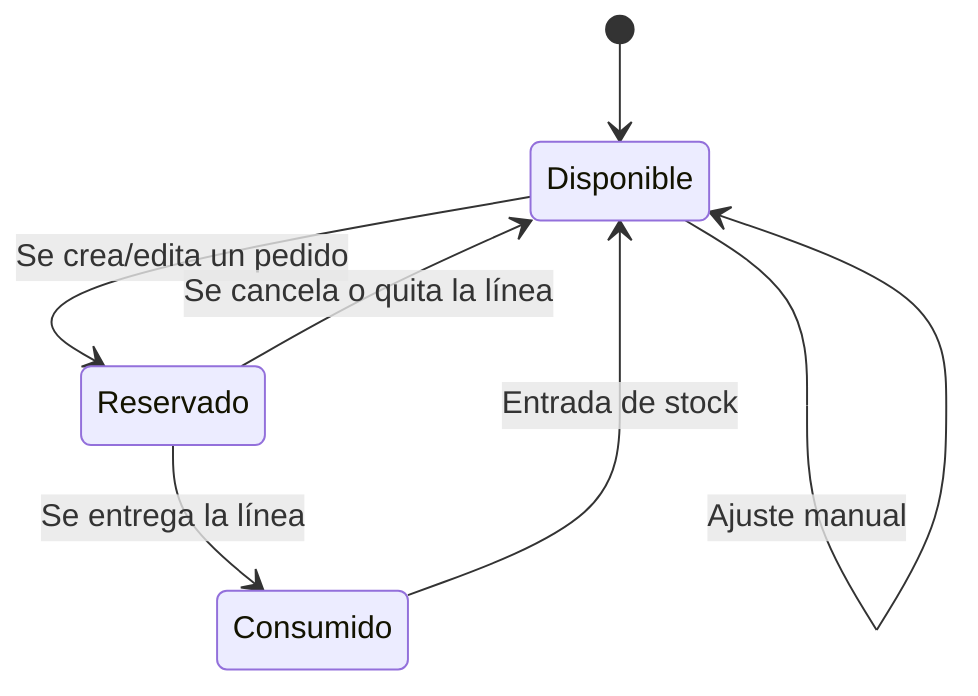

| Acción | Movimiento registrado | Efecto |
|---|---|---|
| Crear pedido | `reserva` | `stockReservado += cantidad` |
| Cancelar/quitar línea | `liberacion` | `stockReservado -= cantidad` |
| Entregar línea | `consumo` | `stock -= cantidad`, `stockReservado -= cantidad` |
| Entrada de stock | `reabastecimiento` | `stock += cantidad` |
| Ajuste | `ajuste_manual` | Cambia stock con historial |

### 7.3 Disponibilidad

`GET /recetas/disponibilidad` responde cuántas unidades se pueden preparar:

- Plato con receta: mínimo entre `disponible / cantidad_requerida` de cada
  ingrediente.
- Plato sin receta: `disponible: null` (no se controla).
- Bebida/producto: unidades disponibles de su propio stock.

Si falta algo, devuelve el motivo, por ejemplo:

```
Sin queso (0,250 kg)
```

### 7.4 Alertas

Cada 5 minutos se revisa el inventario:

- Si `stock <= stockMinimo` (y el mínimo es mayor que 0) → notificación.
- Si un insumo se repone → se elimina la alerta pendiente.
- Se agrupan por `refId` para no duplicar avisos.

---

## 8. Compras

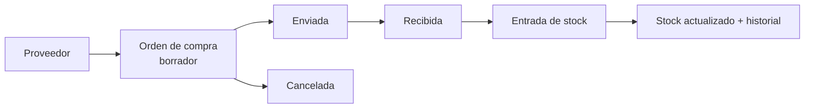

- La orden de compra agrupa ingredientes y precios.
- Al recibirla se registra una **entrada de stock**.
- La entrada guarda `stockAntes`, `cantidad` y `stockDespues`.

---

## 9. Notificaciones

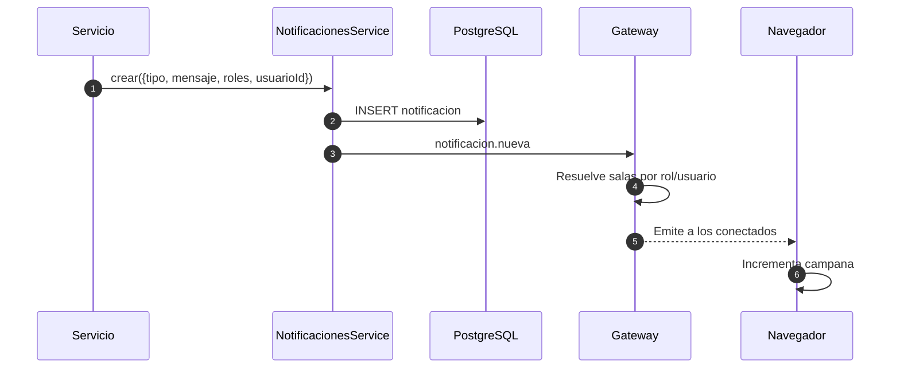

Tipos:

| Tipo | Cuándo |
|---|---|
| `pedido` | Se crea un pedido |
| `pedido_listo` | Cocina termina una línea |
| `factura` | Se genera una factura |
| `inventario` | Stock bajo o pedido abandonado |
| `mesero` | Avisos operativos |
| `proveedor` | Avisos de compras |

Reglas:

- El creador **no** recibe su propia notificación.
- Se guardan 50 visibles como máximo en la consulta.
- Cada usuario marca sus propias leídas (tabla `notificacion_leida`).

---

## 10. Dashboard y reportes

### Dashboard (`/dashboard`)

Calcula en zona `America/Bogota`:

- Ventas de hoy y de ayer a la misma hora.
- Variación porcentual y proyección del día.
- Ticket promedio.
- Ventas por hora (hoy y ayer).
- Mesas ocupadas.
- Pedidos en proceso, en preparación y listos.
- Insumos y productos por agotarse (top 5).
- Últimos movimientos.

### Reportes

| Reporte | Contenido |
|---|---|
| Ventas del día | Totales y transacciones del día |
| Ventas por rango | Totales entre dos fechas |
| Productos vendidos | Ranking por cantidad e ingresos |
| Consumo de insumos | Ingredientes usados |
| Por mesero | Ventas y cuentas por mesero |

Se pueden ver en pantalla, exportar a CSV o imprimir a PDF desde el navegador.

---

## 11. Resumen de reglas que no se pueden romper

1. Una mesa libre se ocupa al crear el pedido; no puede tener dos pedidos.
2. No se vende stock que no existe (reserva atómica).
3. No se cobra un pedido con ítems pendientes.
4. No se cobra dos veces la misma cuenta.
5. No se cobra sin caja abierta, salvo autorización de administrador con motivo.
6. No se cierra caja con diferencia sin explicar el motivo.
7. No se anula una factura pagada.
8. No se edita un movimiento de caja: se revierte.
9. Un mesero no modifica pedidos de otro.
10. Un pedido con factura pendiente no se edita hasta pagarla o anularla.
