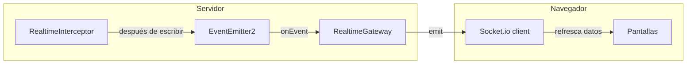
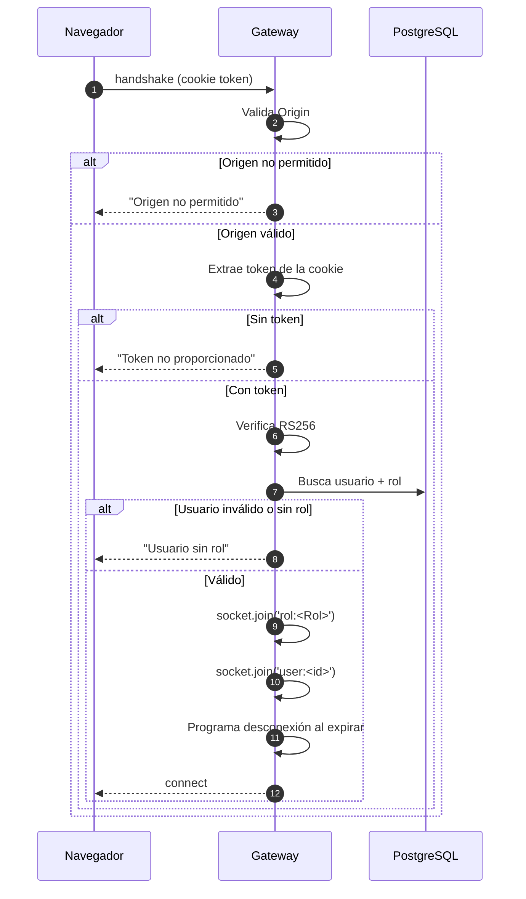

# 08 · Tiempo real (Socket.io)

## 1. Para qué sirve

Mantener sincronizadas todas las pantallas sin recargar:

- Pedidos nuevos o modificados.
- Mesas que cambian de estado.
- Facturas cobradas o anuladas.
- Notificaciones de cocina, inventario y caja.

Si el socket falla, la aplicación **sigue funcionando** con sondeo periódico.

---

## 2. Arquitectura



1. Una petición de escritura termina en el backend.
2. `RealtimeInterceptor` emite un evento interno según la ruta.
3. El gateway lo retransmite con **debounce de 250 ms**.
4. El navegador recibe y vuelve a cargar sus datos.

---

## 3. Eventos

| Evento | Se emite cuando | Pantallas que lo usan |
|---|---|---|
| `pedidos.changed` | Crear/editar/cobrar pedido | Pedidos, Cocina, Mesas |
| `mesas.changed` | Cambia una mesa o un pedido | Mesas, Pedidos |
| `facturas.changed` | Se paga o anula una factura | Facturación, Caja |
| `notificacion.nueva` | Se crea una notificación | Campana global |

### Emisión por ruta

| Ruta que se modificó | Eventos |
|---|---|
| `/pedidos/*` | `pedidos.changed` + `mesas.changed` |
| `/detalle-pedido/*` | `pedidos.changed` |
| `/facturas/*` | `facturas.changed` + `mesas.changed` |
| `/mesas/*` | `mesas.changed` |

Solo se emiten en métodos de escritura (`POST`, `PATCH`, `PUT`, `DELETE`). Los
`GET` no generan eventos.

### Debounce

Si en 250 ms llegan 10 cambios, se emite **un solo** evento. Esto evita que una
ráfaga de peticiones sature a los navegadores.

---

## 4. Autenticación del socket

El socket **no** usa el header `Authorization`. Usa la misma cookie httpOnly de
la sesión.



Detalles:

- La cookie se lee con `cookie.parse`.
- El token se verifica con `JwtService` (RS256).
- Se consulta el usuario en la base para confirmar que sigue activo.
- Al llegar la expiración del JWT, el socket se desconecta solo.
- Si el usuario se desactiva, el token deja de validar en la siguiente
  petición, pero un socket ya conectado puede seguir hasta expirar. Para cortar
  de inmediato habría que invalidar sesiones (mejora pendiente).

---

## 5. Validación de origen

El `cors` del decorador cubre el **polling**, pero no el WebSocket puro. Por eso
el gateway valida el `Origin` en `server.use` con el mismo validador del
backend:

| Origen | Resultado |
|---|---|
| `http://localhost:3001` | Permitido |
| `http://127.0.0.1:3001` | Permitido |
| `http://192.168.1.47:3001` | Permitido |
| `http://10.0.0.8:9999` | Permitido |
| `https://evil.example.com` | **Rechazado** |

Pruebas reales ejecutadas:

| Caso | Resultado |
|---|---|
| Origen privado + cookie válida | Conecta |
| Origen localhost + cookie válida | Conecta |
| Origen público + cookie válida | `Origen no permitido` |
| Sin cookie | `Token no proporcionado` |

---

## 6. Salas

El gateway usa salas para enviar notificaciones solo a quien corresponde:

| Sala | Quién entra |
|---|---|
| `rol:Administrador` | Usuarios con rol Administrador |
| `rol:Mesero` | Usuarios con rol Mesero |
| `rol:Chef` | Usuarios con rol Chef |
| `rol:Cajero` | Usuarios con rol Cajero |
| `user:<id>` | Usuario específico |

Una notificación se envía a la unión de las salas indicadas. Si el usuario que
la creó está en esas salas, **se omite** para no notificarse a sí mismo.

---

## 7. Cliente

```ts
// restorapp-nextjs/src/lib/socket.ts
const socket = io(base, {
  transports: ['websocket'],
  withCredentials: true,
  reconnectionDelay: 1000,
  reconnectionDelayMax: 5000,
});
```

### Resolución del host

| Configuración | Base usada |
|---|---|
| `NEXT_PUBLIC_SOCKET_SAME_ORIGIN=true` | `/` (mismo origen) |
| `NEXT_PUBLIC_API_URL` vacío | `/` |
| `NEXT_PUBLIC_API_URL=http://localhost:3000` | `http://<host-de-la-página>:3000` |

Esto resuelve el problema clásico:

1. El usuario entra por `http://192.168.1.47:3001`.
2. La cookie pertenece a `192.168.1.47`.
3. Si el socket apuntara a `localhost:3000`, la cookie no viajaría.
4. Al usar el host de la página, la cookie sí viaja.

### Reconexión

- Reintenta cada 1–5 segundos.
- Al reconectar, `useLiveData` y `useNotifications` recargan los datos.
- El usuario ve el estado real, no el que tenía antes de la caída.

---

## 8. Respaldo por sondeo

`useLiveData` refresca cada 60 segundos aunque el socket esté conectado. Si el
socket se cae, la pantalla sigue actualizándose (más lento, pero correcta).

| Situación | Comportamiento |
|---|---|
| Socket conectado | Actualización instantánea + sondeo cada 60 s |
| Socket caído | Solo sondeo cada 60 s |
| Sin red | Se muestran los últimos datos y se reintenta |

Este diseño evita depender de un único canal.

---

## 9. Indicador visual

`LiveIndicator` muestra si la conexión está activa. Si no lo está, aparece el
aviso de "Sin conexión en vivo". En las pruebas de aceptación se verificó que
**no aparece** en `localhost` ni en la IP de la LAN.

---

## 10. Diagnóstico

| Síntoma | Causa probable | Solución |
|---|---|---|
| "Sin conexión en vivo" | Socket apuntando a otro host | Revisar `NEXT_PUBLIC_API_URL` y `NEXT_PUBLIC_SOCKET_SAME_ORIGIN` |
| `Token no proporcionado` | Cookie no viaja | Mismo origen o `withCredentials: true` |
| `Origen no permitido` | Origen público o IP no privada | Usar LAN/VPN o HTTPS con el origen configurado |
| Conecta pero no actualiza | Evento no emitido | Revisar si la ruta es de escritura y si el interceptor la cubre |
| Se desconecta cada hora | Expiración del JWT (1 h) | Volver a iniciar sesión; el socket se reconecta |

### Prueba manual rápida

```bash
# Verificar que el gateway responde
curl -i "http://127.0.0.1:3000/socket.io/?EIO=4&transport=polling"
```

Debe devolver `200` con un `sid`. Si devuelve error, el gateway no está
levantado.

---

## 11. Límites conocidos

- El estado de bloqueo de login es en memoria (no aplica al socket).
- Un socket conectado no se corta al instante si desactivan al usuario; dura
  hasta que expire el token.
- El debounce es por evento, no por usuario.
- No hay historial de eventos: solo el estado actual.
