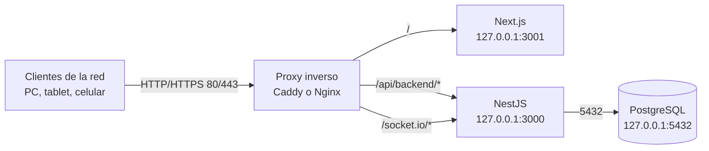

# 10 · Despliegue seguro

## 1. Arquitectura recomendada



Principios:

1. **Un solo origen** para el navegador: sin CORS y con cookie/socket en el
   mismo host.
2. **Backend y base ocultos**: escuchan solo en `127.0.0.1`.
3. **Un único puerto expuesto** a la red: el del proxy.
4. **HTTPS o VPN** si el sistema sale de la red local.

---

## 2. Requisitos

| Componente | Versión |
|---|---|
| Sistema | Linux (Ubuntu 22.04/24.04 recomendado) |
| Node.js | 18 LTS o superior |
| PostgreSQL | 13 o superior |
| Proxy | Caddy 2 o Nginx |
| RAM | 1 GB mínimo (2 GB recomendado) |
| Disco | 5 GB + espacio para respaldos |

---

## 3. Instalación paso a paso

### 3.1 Copiar el proyecto

```bash
# Desde el equipo de origen
rsync -av --exclude node_modules --exclude .next --exclude dist \
  RESTORAPP/ usuario@servidor:/opt/restorapp/
```

### 3.2 Dependencias

```bash
cd /opt/restorapp/prime-nestjs
npm ci --ignore-scripts

cd ../restorapp-nextjs
npm ci --ignore-scripts
```

### 3.3 Base de datos

**Instalación nueva:**

```bash
sudo -u postgres createdb restorapp
cp prime-nestjs/.env.example prime-nestjs/.env
# Editar .env con los datos reales
cd prime-nestjs && npm run migration:run
```

**Con datos existentes:**

```bash
# Restaurar el respaldo
pg_restore -U postgres -d restorapp --clean --if-exists respaldo.dump
# Aplicar migraciones pendientes
cd prime-nestjs && npm run migration:run
```

### 3.4 Configuración

Crear `prime-nestjs/.env` y `restorapp-nextjs/.env` según el perfil de
producción del documento 09. Permisos:

```bash
chmod 600 prime-nestjs/.env restorapp-nextjs/.env
```

### 3.5 Compilar

> **Detener cualquier `next dev` antes de compilar.** En Next 14, `dev` y
> `build` comparten `.next` y se rompen entre sí.

```bash
cd /opt/restorapp/prime-nestjs
npm run build

cd ../restorapp-nextjs
rm -rf .next
npm run build
```

### 3.6 Probar antes del proxy

```bash
cd /opt/restorapp/prime-nestjs
npm run start:prod &

cd ../restorapp-nextjs
npm run start &

curl http://127.0.0.1:3000/health-check
curl -I http://127.0.0.1:3001/login
```

Si ambos responden, detenerlos y pasar a systemd.

---

## 4. Servicios con systemd

### 4.1 Backend

`/etc/systemd/system/restorapp-api.service`

```ini
[Unit]
Description=RestorApp API (NestJS)
After=network.target postgresql.service
Wants=postgresql.service

[Service]
Type=simple
User=restorapp
WorkingDirectory=/opt/restorapp/prime-nestjs
EnvironmentFile=/opt/restorapp/prime-nestjs/.env
ExecStart=/usr/bin/node dist/main
Restart=always
RestartSec=5
StandardOutput=journal
StandardError=journal

# Endurecimiento
NoNewPrivileges=true
PrivateTmp=true
ProtectSystem=strict
ProtectHome=true
ReadWritePaths=/opt/restorapp/prime-nestjs

[Install]
WantedBy=multi-user.target
```

### 4.2 Frontend

`/etc/systemd/system/restorapp-web.service`

```ini
[Unit]
Description=RestorApp Web (Next.js)
After=network.target restorapp-api.service

[Service]
Type=simple
User=restorapp
WorkingDirectory=/opt/restorapp/restorapp-nextjs
EnvironmentFile=/opt/restorapp/restorapp-nextjs/.env
ExecStart=/usr/bin/node node_modules/next/dist/bin/next start -p 3001
Restart=always
RestartSec=5
StandardOutput=journal
StandardError=journal

NoNewPrivileges=true
PrivateTmp=true
ProtectSystem=strict
ProtectHome=true
ReadWritePaths=/opt/restorapp/restorapp-nextjs

[Install]
WantedBy=multi-user.target
```

### 4.3 Activar

```bash
sudo useradd -r -s /usr/sbin/nologin restorapp
sudo chown -R restorapp:restorapp /opt/restorapp

sudo systemctl daemon-reload
sudo systemctl enable --now restorapp-api restorapp-web

sudo systemctl status restorapp-api
sudo systemctl status restorapp-web
```

---

## 5. Proxy inverso

### 5.1 Caddy (recomendado por simplicidad)

El proyecto ya incluye `deploy/Caddyfile.example`:

```caddyfile
:80 {
    encode gzip

    handle /api/backend/* {
        uri strip_prefix /api/backend
        reverse_proxy 127.0.0.1:3000
    }

    handle /socket.io/* {
        reverse_proxy 127.0.0.1:3000
    }

    handle {
        reverse_proxy 127.0.0.1:3001
    }
}
```

Instalar y arrancar:

```bash
sudo apt install caddy
sudo cp deploy/Caddyfile.example /etc/caddy/Caddyfile
sudo systemctl reload caddy
```

### 5.2 HTTPS local con Caddy

```caddyfile
https://restorapp.local {
    tls internal
    encode gzip

    handle /api/backend/* {
        uri strip_prefix /api/backend
        reverse_proxy 127.0.0.1:3000
    }
    handle /socket.io/* {
        reverse_proxy 127.0.0.1:3000
    }
    handle {
        reverse_proxy 127.0.0.1:3001
    }
}
```

En cada equipo cliente:

```bash
caddy trust
```

Y en el archivo `hosts` del cliente:

```
192.168.1.47   restorapp.local
```

Con HTTPS cambiar en el frontend:

```env
COOKIE_SECURE=true
```

### 5.3 Nginx

El proyecto incluye `deploy/nginx.restorapp.conf.example`. Resumen:

```nginx
server {
    listen 80;
    server_name _;

    client_max_body_size 10m;

    location /api/backend/ {
        proxy_pass http://127.0.0.1:3000/;
        proxy_set_header Host $host;
        proxy_set_header X-Real-IP $remote_addr;
        proxy_set_header X-Forwarded-For $proxy_add_x_forwarded_for;
        proxy_set_header X-Forwarded-Proto $scheme;
    }

    location /socket.io/ {
        proxy_pass http://127.0.0.1:3000;
        proxy_http_version 1.1;
        proxy_set_header Upgrade $http_upgrade;
        proxy_set_header Connection "upgrade";
        proxy_set_header Host $host;
    }

    location / {
        proxy_pass http://127.0.0.1:3001;
        proxy_set_header Host $host;
        proxy_set_header X-Forwarded-For $proxy_add_x_forwarded_for;
        proxy_set_header X-Forwarded-Proto $scheme;
    }
}
```

> El `Connection "upgrade"` es obligatorio para que Socket.io funcione.

---

## 6. Firewall

```bash
sudo ufw default deny incoming
sudo ufw default allow outgoing
sudo ufw allow 22/tcp        # SSH (restringir a la red admin si es posible)
sudo ufw allow 80/tcp        # HTTP del proxy
sudo ufw allow 443/tcp       # HTTPS del proxy
sudo ufw enable
```

**No abrir** `3000`, `3001` ni `5432` a la red.

---

## 7. HTTPS o VPN

| Escenario | Recomendación |
|---|---|
| Solo red local del restaurante | HTTP + proxy + WiFi con clave |
| Varias sedes o acceso remoto | **VPN** (Tailscale/WireGuard) |
| Exposición a internet | **HTTPS obligatorio** con dominio y certificado |
| Tablets en la misma red | HTTP es aceptable; HTTPS si hay datos sensibles |

Regla: **nunca** publiques el sistema a internet sin HTTPS y sin desactivar las
cuentas demo.

---

## 8. Checklist de puesta en marcha

### Antes de arrancar

- [ ] `.env` creados y con permisos `600`
- [ ] Claves RSA generadas y cargadas
- [ ] Contraseña de PostgreSQL fuerte
- [ ] Base creada y migraciones aplicadas
- [ ] Respaldo inicial realizado
- [ ] `NODE_ENV=production`
- [ ] `HOST=127.0.0.1` en backend y frontend
- [ ] `TRUST_PROXY=true`
- [ ] `COOKIE_SECURE` coherente con HTTP/HTTPS
- [ ] Cuentas demo desactivadas
- [ ] Contraseñas reales cambiadas

### Después de arrancar

- [ ] `/health-check` responde `200`
- [ ] El frontend carga en `http://IP/`
- [ ] El login funciona
- [ ] El dashboard muestra datos
- [ ] El socket conecta (sin "Sin conexión en vivo")
- [ ] Se puede crear un pedido de prueba
- [ ] Se puede cobrar (con caja abierta)
- [ ] La impresión de ticket funciona
- [ ] Los servicios vuelven tras reiniciar el servidor
- [ ] El respaldo programado está activo

---

## 9. Verificación posterior

```bash
# Servicios
systemctl is-active restorapp-api restorapp-web caddy

# Salud
curl -s http://127.0.0.1:3000/health-check

# Proxy
curl -s -o /dev/null -w "%{http_code}\n" http://IP-DEL-SERVIDOR/

# API a través del proxy
curl -s -o /dev/null -w "%{http_code}\n" http://IP-DEL-SERVIDOR/api/backend/health-check

# Puertos expuestos
sudo ss -ltnp | grep -E ':80|:443|:3000|:3001|:5432'
```

Resultado esperado: solo `80`/`443` escuchando en `0.0.0.0`; `3000`, `3001` y
`5432` solo en `127.0.0.1`.

---

## 10. Actualizaciones

```bash
# 1. Respaldar
docker exec app_postgres_dev pg_dump -U postgres -d postgres -Fc > respaldo_$(date +%F).dump

# 2. Detener servicios
sudo systemctl stop restorapp-web restorapp-api

# 3. Actualizar código
cd /opt/restorapp && git pull   # o rsync

# 4. Dependencias y migraciones
cd prime-nestjs && npm ci --ignore-scripts && npm run migration:run && npm run build
cd ../restorapp-nextjs && npm ci --ignore-scripts && rm -rf .next && npm run build

# 5. Arrancar
sudo systemctl start restorapp-api restorapp-web

# 6. Verificar
curl -s http://127.0.0.1:3000/health-check
```

---

## 11. Reversión

```bash
# Código
cd /opt/restorapp && git checkout <commit-anterior>

# Base (si la migración causó el problema)
cd prime-nestjs && npm run migration:revert

# Recompilar y reiniciar
npm run build
cd ../restorapp-nextjs && rm -rf .next && npm run build
sudo systemctl restart restorapp-api restorapp-web
```

Si el problema es grave: restaurar el respaldo previo y volver al commit
anterior.

---

## 12. Alternativa con Docker

El proyecto incluye `prime-nestjs/docker-compose.yml` para backend + base:

```bash
cd prime-nestjs
docker compose build
docker compose up -d
docker compose ps
```

Ya publica los puertos solo en `127.0.0.1`. El frontend puede correr con
systemd o en otro contenedor. En ambos casos, el proxy sigue siendo el único
punto de entrada.
