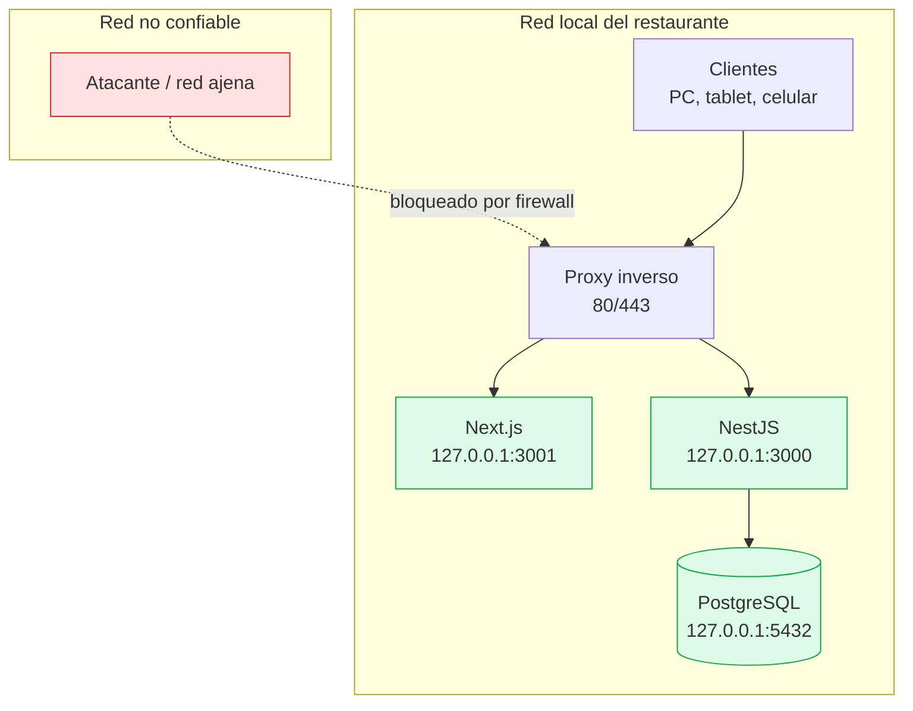
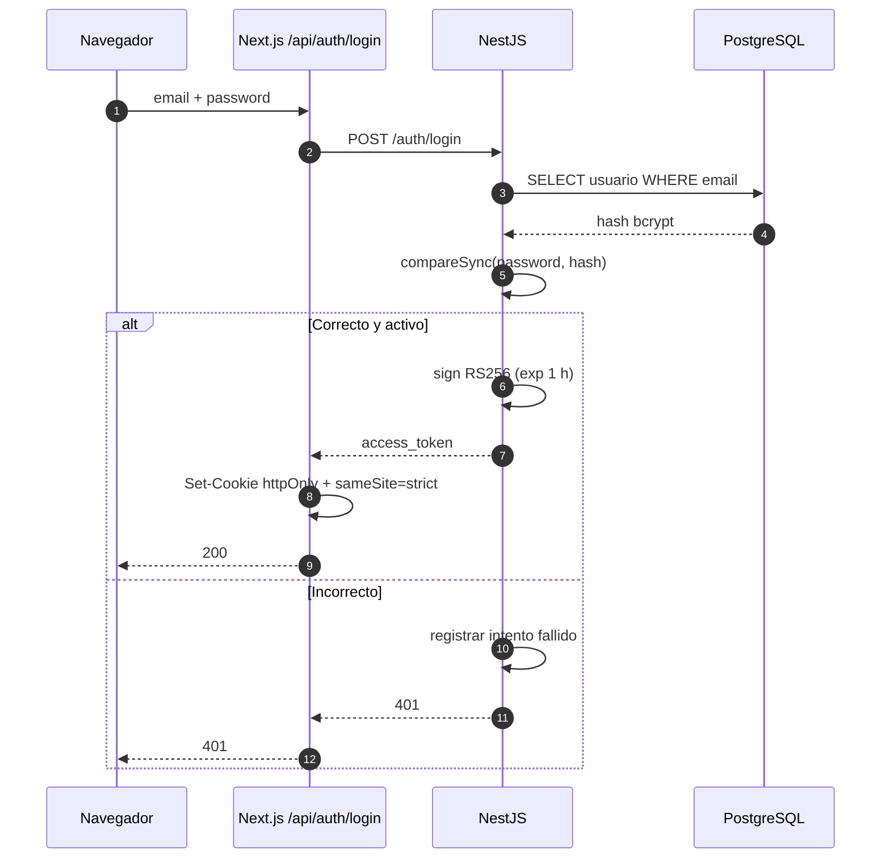
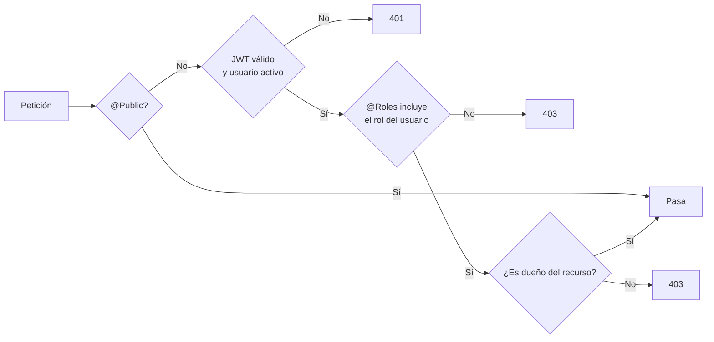
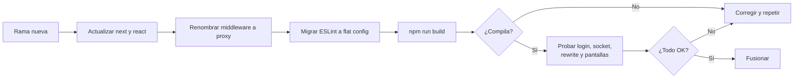

# 12 · Seguridad

Este documento describe **lo que el sistema protege hoy**, **lo que no**, y qué
habría que hacer antes de exponerlo fuera de la red local. No es una lista de
deseos: cada control indicado existe en el código y se puede verificar.

---

## 1. Modelo de amenazas

El sistema está pensado para operar en la **red local de un restaurante**. Ese
contexto define el nivel de riesgo:

| Activo | Riesgo principal |
|---|---|
| Cuentas de usuario | Robo de credenciales, fuerza bruta |
| Sesiones | Robo de cookie, XSS, CSRF |
| Caja y facturación | Manipulación de montos, doble cobro |
| Inventario | Venta de stock inexistente o descuadre |
| Base de datos | Acceso directo, borrado accidental |
| Backend | Exposición de API, fuga de errores internos |
| Reportes | Acceso a información financiera por roles no autorizados |



**Supuesto de diseño:** el servidor y los clientes están en una red privada
controlada. Si el sistema se publica a internet, se deben cumplir **todos** los
puntos de la sección 10.

---

## 2. Controles implementados

### 2.1 Autenticación

| Control | Implementación | Archivo |
|---|---|---|
| Hash de contraseñas | `bcryptjs`, costo 10 | `usuarios/entities/usuario.entity.ts` |
| Firma del token | JWT **RS256** con clave privada | `auth/auth.module.ts` |
| Verificación | Clave pública, algoritmo fijado a `RS256` | `auth/strategy/jwt.strategy.ts` |
| Vigencia | 1 hora (`expiresIn: '1h'`) | `auth/auth.module.ts` |
| Cookie | `httpOnly`, `sameSite=strict`, `path=/` | `app/api/auth/login/route.ts` |
| Token en dos canales | Cookie `token` **o** `Authorization: Bearer` | `jwt.strategy.ts` |
| Usuario recargado | Cada petición consulta el usuario en la base | `jwt.strategy.ts` |
| Cuenta desactivada | Se rechaza aunque el token sea válido | `jwt.strategy.ts` |
| No exponer el hash | `@Exclude()` + `ClassSerializerInterceptor` | `usuario.entity.ts`, `main.ts` |

> **Detalle de vigencia:** el JWT dura **1 hora**, pero la cookie se guarda con
> `maxAge` de **8 horas**. Pasada la hora, la API responde `401`, el layout del
> dashboard borra la cookie y redirige a `/login?expired=1`. No es una sesión de
> 8 horas reales: la cookie solo evita perder el formulario antes de que el
> backend valide el token.



### 2.2 Autorización

- `JwtAuthGuard` **global** en `app.module.ts`; solo `/`, `/health-check` y
  `/auth/login` son públicos.
- `RolesGuard` + `@Roles(...)` en cada controlador.
- Reglas de propiedad en el servicio: un mesero solo modifica sus pedidos.
- El rol se lee del **usuario en base de datos**, no del token. Si cambian el
  rol o desactivan la cuenta, el cambio aplica en la siguiente petición.



### 2.3 Protección contra fuerza bruta

Hay **dos capas**:

| Capa | Límite | Ámbito | Persistencia |
|---|---|---|---|
| `@Throttle` en login | 10 intentos/minuto | Por IP | Memoria del proceso |
| Bloqueo por cuenta | 8 fallos → 5 minutos | Por correo | Memoria del proceso |

Además, el `ThrottlerGuard` global limita a **100 peticiones/minuto por IP**.

> Limitación real: ambos contadores viven en la memoria del proceso. Con una
> sola instancia funcionan; con varias réplicas habría que usar Redis.

### 2.4 Validación de entrada

`ValidationPipe` global con:

- `whitelist: true` → elimina campos no declarados.
- `transform: true` → convierte tipos.
- `forbidNonWhitelisted: true` → **rechaza** campos desconocidos con `400`.

Consecuencias:

- No se puede inyectar un campo arbitrario en un DTO.
- Los montos tienen `@Min`, `@Max` y `maxDecimalPlaces`.
- Los enums (`modo`, `rolTurno`, `tipo`) están restringidos con `@IsIn` /
  `@IsEnum`.
- Los textos tienen `@MaxLength`.

### 2.5 Consultas a la base de datos

- TypeORM usa **consultas parametrizadas**; no se concatena SQL con entrada del
  usuario.
- `synchronize: false`: el esquema no se altera solo.
- Las operaciones críticas usan transacciones y bloqueo pesimista
  (`pessimistic_write`, `pessimistic_read`).
- Restricciones de integridad: `UNIQUE`, claves foráneas, índice único parcial
  para el turno abierto.
- Los errores de PostgreSQL se traducen en `DatabaseExceptionFilter` y **nunca**
  se devuelve el SQL ni el stack trace.

### 2.6 Cabeceras y CORS

`helmet()` agrega cabeceras seguras por defecto:

| Cabecera | Efecto |
|---|---|
| `X-Content-Type-Options: nosniff` | Evita adivinar el tipo de contenido |
| `X-Frame-Options: SAMEORIGIN` | Mitiga clickjacking |
| `Strict-Transport-Security` | Solo tiene efecto real sobre HTTPS |
| `Content-Security-Policy` | Política por defecto de helmet |
| `Referrer-Policy` | Limita la información de origen |

**CORS** (`src/common/cors-origin.ts`):

- Permite peticiones sin `Origin` (curl, apps nativas).
- Permite orígenes configurados en `ALLOWED_ORIGINS`.
- Permite `localhost`, `127.0.0.1`, `::1` y rangos privados
  (`10/8`, `192.168/16`, `172.16–31/12`) en cualquier puerto.
- Rechaza cualquier origen público.

Esto es deliberado: permite mover el sistema de máquina o de IP sin recompilar,
pero **solo dentro de la red privada**. Un dominio público debe agregarse
explícitamente a `ALLOWED_ORIGINS`.

### 2.7 Tiempo real

El gateway Socket.io:

1. Valida el `Origin` del handshake con el mismo validador de CORS.
2. Extrae el token de la cookie `token`.
3. Verifica la firma RS256.
4. Consulta el usuario en la base y confirma que esté activo.
5. Une el socket a `rol:<Rol>` y `user:<id>`.
6. Programa la desconexión al expirar el token.

| Caso probado | Resultado |
|---|---|
| Origen privado + cookie válida | Conecta |
| `localhost` + cookie válida | Conecta |
| Origen público + cookie válida | `Origen no permitido` |
| Sin cookie | `Token no proporcionado` |

### 2.8 Secretos y configuración

| Medida | Estado |
|---|---|
| `.env` fuera de Git | Sí (`.gitignore` raíz y de cada proyecto) |
| Permisos de `.env` | `600` (verificado) |
| Plantillas sin secretos | `.env.example` en ambos proyectos |
| Claves RSA fuera del repositorio | Recomendado en el documento 09 |
| Swagger desactivado en producción | Sí (`NODE_ENV=production`) |
| Contraseñas en logs | No se registran |
| Token en `localStorage` | No se usa |

### 2.9 Cuentas demo

Existen cuentas de demostración con correos terminados en
`.demo@restorapp.co` y contraseñas débiles.

| Aspecto | Detalle |
|---|---|
| Creación | `npm run seed:usuarios-demo` |
| Detección | `scripts/desactivar-cuentas-demo.js` (patrón de correo) |
| Desactivación | `npm run security:demo-off` |
| Alcance | Pone `isActive = false`; **no borra** |
| Reversión | Se pueden reactivar desde Usuarios |

> **Antes de producción:** ejecutar `npm run security:demo-off` y verificar que
> no quede ninguna cuenta demo activa. El script primero muestra qué haría; solo
> cambia datos con `--aplicar` (que ya incluye el comando `security:demo-off`).

---

## 3. Riesgos residuales

Clasificación: **Crítico** = compromete datos o dinero; **Alto** = acceso no
autorizado; **Medio** = requiere condiciones; **Bajo** = impacto limitado.

| # | Riesgo | Nivel | Estado actual | Mitigación recomendada |
|---|---|---|---|---|
| 1 | Dependencias vulnerables del frontend (`next` 14, `postcss`) | **Crítico** | 2 vulnerabilidades: 1 crítica, 1 alta | Actualizar a `next@16.4.5` (cambio mayor, ver sección 6) |
| 2 | Dependencias vulnerables del backend | **Alto** | 17 (9 altas, 8 moderadas) | `npm audit fix`; revisar `qs`/`express` |
| 3 | Sin HTTPS por defecto | **Alto** si sale de la LAN | HTTP en red local | Proxy con TLS (documento 10) |
| 4 | Cuentas demo activas | **Alto** | Activas en la base actual | `npm run security:demo-off` |
| 5 | Bloqueo de login en memoria | Medio | Una instancia | Redis si hay varias réplicas |
| 6 | Sin revocación inmediata de sesión | Medio | El JWT dura 1 h | Lista negra o versionado de tokens |
| 7 | Socket no se corta al desactivar usuario | Medio | Dura hasta expirar el token | Invalidar salas al desactivar |
| 8 | Sin CSRF token explícito | Medio | `sameSite=strict` + cookie httpOnly | Añadir token si se abre a terceros |
| 9 | Sin auditoría de acciones | Medio | Solo logs de aplicación | Tabla de auditoría (quién, qué, cuándo) |
| 10 | Sin política de contraseñas | Medio | Mínimo 8 caracteres | Exigir complejidad y caducidad |
| 11 | Sin 2FA | Bajo en LAN | No implementado | TOTP para administradores |
| 12 | Sin cifrado de respaldos | Medio | `.dump` en claro | Cifrar con GPG/age |
| 13 | Sin límite de tamaño de body global | Bajo | Límite por defecto de Express | Ajustar en el proxy |
| 14 | Swagger expuesto en desarrollo | Bajo | Activo con `NODE_ENV != production` | No usar desarrollo en el servidor real |
| 15 | Logs sin rotación por defecto | Bajo | Journald/Docker | Configurar retención |

### 3.1 Detalle de dependencias

Resultado real de `npm audit` al documentar:

**Backend (`prime-nestjs`)**

```
17 vulnerabilidades (8 moderadas, 9 altas)
cadena principal: qs → body-parser → express → @nestjs/platform-express
```

**Frontend (`restorapp-nextjs`)**

```
2 vulnerabilidades (1 alta, 1 crítica)
next  →  requiere next@16.4.5 (cambio mayor)
postcss
```

Ninguna de estas vulnerabilidades se explota automáticamente por usar el
sistema en LAN, pero **sí** son un riesgo real si el servidor se expone.

---

## 4. Auditoría y trazabilidad

### 4.1 Qué se registra hoy

| Evento | Dónde | Nivel |
|---|---|---|
| Arranque de la aplicación | Log de Nest | Info |
| Error no controlado | Log + respuesta genérica | Error |
| Error de base traducido | Log del filtro | Warn/Error |
| Intentos de login fallidos | Contador en memoria | No persistente |
| Acciones de negocio | **No se auditan** | — |

### 4.2 Qué falta para una auditoría formal

Una tabla como esta permitiría responder “quién anuló esta factura”:

| Campo | Ejemplo |
|---|---|
| `usuarioId` | 4 |
| `accion` | `factura.anular` |
| `entidad` | `factura` |
| `entidadId` | 18 |
| `datosAntes` / `datosDespues` | JSON |
| `ip` | 192.168.1.20 |
| `createdAt` | timestamp |

No existe en esta versión. Es una mejora recomendada, no un defecto oculto.

---

## 5. Protección de datos

| Dato | Tratamiento actual |
|---|---|
| Contraseña | Hash bcrypt, nunca se devuelve |
| Token JWT | Cookie httpOnly; no accesible por JavaScript |
| Correo y nombre | Visibles para usuarios autenticados |
| Ventas y facturas | Solo ADMIN y CAJERO |
| Reportes financieros | ADMIN, MESERO, CAJERO (según ruta) |
| Stock e ingredientes | Cualquier usuario autenticado |
| Respaldos | Archivos planos en el servidor |

**Recomendaciones:**

1. Restringir los reportes financieros a ADMIN y CAJERO (hoy MESERO también
   accede a varios).
2. No incluir datos personales en logs.
3. Cifrar los respaldos si salen del servidor.
4. Definir una política de retención (por ejemplo, 12 meses).

---

## 6. Plan de actualización a Next 16

La vulnerabilidad crítica del frontend **solo se corrige** subiendo a
`next@16.4.5`. Es un cambio mayor y requiere una sesión aparte con pruebas.

### 6.1 Cambios necesarios

| Tema | Next 14 (actual) | Next 16 |
|---|---|---|
| Middleware | `src/middleware.ts` | `src/proxy.ts` (nuevo nombre) |
| Lint | `next lint` | ESLint 9 con *flat config* |
| Bundler | Webpack | Turbopack por defecto |
| Node.js | ≥ 18 | ≥ 20.9 |
| React | 18 | 18.2+ (compatible) |
| `next.config.js` | CommonJS | Igual, revisar opciones obsoletas |

### 6.2 Procedimiento seguro



Pasos concretos:

```bash
cd restorapp-nextjs
git checkout -b chore/next-16
npm install next@16.4.5 react@latest react-dom@latest
# renombrar middleware.ts -> proxy.ts y ajustar export
# migrar .eslintrc.json a eslint.config.mjs
rm -rf .next
npm run build
npm run dev
```

### 6.3 Pruebas obligatorias tras la actualización

- [ ] `/login` carga con estilos.
- [ ] La cookie se crea y se borra.
- [ ] `/dashboard` redirige sin sesión.
- [ ] El rewrite `/api/backend/*` sigue funcionando.
- [ ] El socket conecta (sin “Sin conexión en vivo”).
- [ ] Pedidos, facturación, caja e inventario cargan datos.
- [ ] El ticket imprime.
- [ ] Los reportes exportan CSV.

Si algo falla, revertir la rama. **No** actualizar en el servidor de producción
sin haber probado antes.

---

## 7. Respuesta a incidentes

### 7.1 Sospecha de robo de credenciales

1. Desactivar la cuenta afectada (`PATCH /usuarios/:id/toggle-active`).
2. Revisar logs de login y accesos.
3. Cambiar la contraseña.
4. Si el token pudo ser robado, **rotar las claves RSA** (invalida todas las
   sesiones).
5. Revisar movimientos de caja y facturas del período.

### 7.2 Fuga de claves RSA

```bash
cd prime-nestjs
openssl genrsa -out private.pem 2048
openssl rsa -in private.pem -pubout -out public.pem
# Actualizar PRIVATE_KEY y PUBLIC_KEY en .env
sudo systemctl restart restorapp-api
```

Todas las sesiones quedan invalidadas: los usuarios deben volver a entrar.

### 7.3 Base de datos comprometida

1. Aislar el servidor de la red.
2. Respaldar el estado actual para investigación.
3. Restaurar un respaldo confiable.
4. Cambiar la contraseña de PostgreSQL y las claves RSA.
5. Revisar integridad de facturas, turnos y stock.

### 7.4 Sitio caído o lento por ataque

1. Revisar `ss -ltnp` y conexiones activas.
2. Revisar logs del proxy y del backend.
3. Bloquear la IP en el firewall.
4. Si hay denegación de servicio, limitar en el proxy.

---

## 8. Checklist de seguridad

### Antes de producción

- [ ] `NODE_ENV=production`
- [ ] Swagger no responde (`/api` da 404)
- [ ] `HOST=127.0.0.1` en backend y frontend
- [ ] Backend, frontend y base **no** escuchan en `0.0.0.0`
- [ ] Firewall: solo 80/443 abiertos
- [ ] `TRUST_PROXY=true` detrás del proxy
- [ ] `COOKIE_SECURE=true` si hay HTTPS
- [ ] Cuentas demo desactivadas
- [ ] Contraseñas reales y fuertes
- [ ] `.env` con permisos `600`
- [ ] Claves RSA propias (no las de ejemplo)
- [ ] Respaldo inicial probado
- [ ] `npm audit` revisado y documentado
- [ ] Logs con retención configurada
- [ ] Plan de actualización de Next 16 aprobado

### Revisión periódica

- [ ] Mensual: `npm audit` en ambos proyectos.
- [ ] Mensual: revisar usuarios activos y roles.
- [ ] Trimestral: probar restauración de respaldo.
- [ ] Semestral: rotar contraseñas de servicios.
- [ ] Anual: revisar el modelo de amenazas.

---

## 9. Lo que **no** hace el sistema

Para evitar falsas expectativas:

| Función | Estado |
|---|---|
| Facturación electrónica DIAN (CUFE, QR) | **No implementada** |
| Firma digital de facturas | No |
| 2FA / MFA | No |
| SSO / OAuth | No |
| Revocación instantánea de JWT | No |
| Auditoría persistente de acciones | No |
| Cifrado en reposo de la base | No (depende del disco) |
| Cifrado de respaldos | No |
| WAF | No |
| Detección de intrusiones | No |
| Escaneo automatizado de dependencias en CI | No |

Estas ausencias están documentadas a propósito: son el punto de partida para
las siguientes iteraciones, no un fallo silencioso.

---

## 10. Si el sistema sale de la red local

Requisitos **mínimos** antes de publicarlo a internet:

1. **HTTPS obligatorio** con certificado válido (no autofirmado).
2. Dominio propio y `ALLOWED_ORIGINS` con ese dominio.
3. `COOKIE_SECURE=true`.
4. Cuentas demo desactivadas y contraseñas rotadas.
5. Firewall: solo 443 (y 22 restringido).
6. Proxy con límite de tasa y tamaño de body.
7. Actualizar Next a 16.4.5 y resolver `npm audit`.
8. Respaldos cifrados y fuera del servidor.
9. Monitoreo y alertas de disponibilidad.
10. Plan de respuesta a incidentes probado.

Sin estos diez puntos, el sistema **no está listo** para internet.
