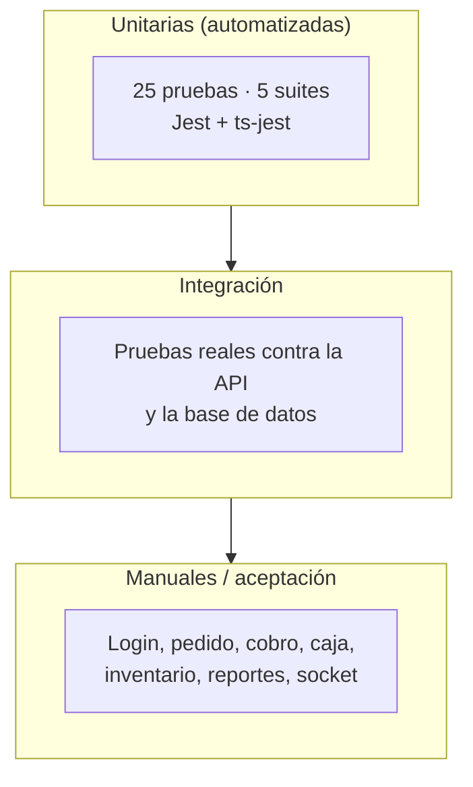
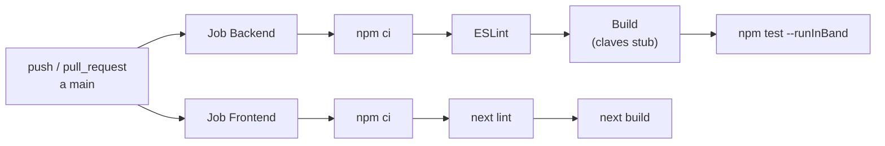

# 13 · Pruebas y calidad

Este documento registra **qué se prueba**, **cómo se ejecuta** y **qué se
verificó realmente**. Las cifras corresponden a la ejecución del
**2026-11-06** sobre Node.js 22.21.1 y npm 10.9.4.

---

## 1. Resumen del estado

| Comprobación | Comando | Resultado |
|---|---|---|
| Pruebas unitarias backend | `npm test -- --runInBand` | **25/25 en verde** (5 suites, 2.1 s) |
| Lint backend | `npx eslint "{src,test}/**/*.ts"` | **0 errores** |
| Build backend | `npm run build` | **Correcto** (`dist/` generado) |
| Lint frontend | `npx next lint` | **0 errores**, 6 advertencias |
| Build frontend | `npm run build` | **Correcto** (19 rutas) |
| TypeScript frontend | incluido en el build | **Sin errores** |
| CI | `.github/workflows/ci.yml` | Configurado para push/PR a `main` |

> El build del frontend se ejecutó en una **copia temporal** para no interferir
> con el `next dev` que estaba corriendo. En Next 14, `dev` y `build` comparten
> `.next` y no deben ejecutarse a la vez.

---

## 2. Pirámide de pruebas



Hoy el sistema tiene una base sólida de **pruebas unitarias** y verificaciones
manuales repetibles. La deuda principal es la **automatización de integración y
de interfaz**.

---

## 3. Pruebas unitarias del backend

### 3.1 Configuración

| Parámetro | Valor |
|---|---|
| Runner | Jest |
| Transformador | `ts-jest` |
| Patrón | `*.spec.ts` dentro de `src/` |
| Entorno | `node` |
| Alias | `src/*` → `<rootDir>/*` |
| Mock de eventos | `src/__mocks__/event-emitter.ts` |
| Cobertura | `npm run test:cov` → `coverage/` |

### 3.2 Suites y casos

#### `auth/auth.service.spec.ts` — 3 pruebas

| Prueba | Qué garantiza |
|---|---|
| Bloquea la cuenta tras varios intentos fallidos | Fuerza bruta controlada |
| Permite iniciar sesión con la contraseña correcta | Login feliz |
| Rechaza una cuenta desactivada aunque la contraseña sea correcta | `isActive` manda |

#### `common/cors-origin.spec.ts` — 6 pruebas

| Prueba | Qué garantiza |
|---|---|
| Permite peticiones sin cabecera `Origin` | curl y apps nativas |
| Permite un origen listado exactamente | `ALLOWED_ORIGINS` |
| Permite `localhost` en cualquier puerto | Desarrollo |
| Permite IPs de red privada en cualquier puerto | Portabilidad en LAN |
| Rechaza orígenes públicos de internet | Aislamiento |
| Rechaza orígenes malformados o con protocolos no HTTP | Robustez |

#### `facturas/facturas.service.spec.ts` — 6 pruebas

| Prueba | Qué garantiza |
|---|---|
| Pagar cobra la factura, cierra líneas y libera la mesa | Flujo completo |
| Pagar rechaza una factura ya pagada | No hay doble cobro |
| Pagar rechaza una factura anulada | Estado coherente |
| Pagar exige un método de pago válido | Integridad del pago |
| Anular marca la factura como anulada | Anulación correcta |
| Anular rechaza una factura ya pagada | No se anula lo cobrado |

#### `pedidos/pedidos.service.spec.ts` — 6 pruebas

| Prueba | Qué garantiza |
|---|---|
| Cobrar en modo caja crea factura pendiente y deja el pedido entregado | Flujo cajero |
| Cobrar rechaza si hay líneas pendientes o en preparación | Regla de cocina |
| Cobrar rechaza cuando ya existe factura pagada | No hay doble cobro |
| Cobrar modo propio exige tipo de pago y libera la mesa | Flujo mesero |
| Entregar línea solo permite estado listo | Transición válida |
| Transferir exige que la mesa destino esté libre | No se pisan mesas |

#### `rol/rol.service.spec.ts` — 4 pruebas

| Prueba | Qué garantiza |
|---|---|
| No permite renombrar un rol del sistema | Integridad de roles base |
| No permite eliminar un rol del sistema | No se rompe el login |
| Sí permite editar la descripción de un rol del sistema | Flexibilidad controlada |
| Permite renombrar un rol personalizado | Roles propios |

### 3.3 Cómo ejecutarlas

```bash
cd prime-nestjs

# Una vez
npm test -- --runInBand

# En modo vigilancia
npm run test:watch

# Con cobertura
npm run test:cov

# Una suite concreta
npm test -- pedidos.service.spec.ts
```

Resultado esperado:

```
Test Suites: 5 passed, 5 total
Tests:       25 passed, 25 total
```

---

## 4. Lint y formato

### 4.1 Backend

- ESLint con `@typescript-eslint` y `prettier`.
- Reglas destacadas: comillas simples, punto y coma obligatorio, `prefer-const`,
  `no-eval`, `eqeqeq`, `max-len` 150.
- Las migraciones quedan exentas de estilo porque se generan automáticamente.

```bash
cd prime-nestjs

# Verificar sin modificar
npx eslint "{src,test}/**/*.ts"

# Corregir automáticamente
npm run lint
```

> El script `npm run lint` usa `--fix` y **modifica archivos**. En una revisión
> sin cambios, usar `npx eslint` sin `--fix`.

### 4.2 Frontend

- `next/core-web-vitals`.
- Reglas de React Hooks y de buenas prácticas de Next.

```bash
cd restorapp-nextjs
npx next lint
```

### 4.3 Advertencias actuales del frontend

No son errores y no rompen el build, pero conviene limpiarlas:

| Archivo | Advertencia |
|---|---|
| `dashboard/usuarios/page.tsx` | `useLayoutEffect` sin dependencia `menuPos.top` |
| `dashboard/usuarios/page.tsx` | `useEffect` sin dependencia `cargarUsuarios` |
| `components/ContextMenu.tsx` | `useLayoutEffect` sin dependencia `menuPos.top` |
| `app/layout.tsx` (×2) | Fuentes personalizadas cargadas con `<link>` |

Impacto real:

- Las de `exhaustive-deps` pueden causar efectos que no se reejecutan cuando
  cambia una posición o un callback. No se observó un fallo funcional, pero es
  deuda técnica.
- Las fuentes por `<link>` funcionan; la advertencia sugiere migrar a
  `next/font` para mejorar la carga.

---

## 5. Compilación

### 5.1 Backend

```bash
cd prime-nestjs
npm run build
```

- `prebuild` limpia `dist/` y `tsconfig.build.tsbuildinfo`.
- `nest build` compila TypeScript.
- Resultado verificado: **sin errores**.

### 5.2 Frontend

```bash
cd restorapp-nextjs
rm -rf .next
npm run build
```

> **Regla:** detener `next dev` antes de compilar. Ambos comparten `.next` en
> Next 14; si no se detiene, la app puede quedar sin estilos o con 404 en los
> chunks.

Resultado real del build aislado:

| Métrica | Valor |
|---|---|
| Rutas generadas | 19 |
| JS compartido | 87.3 kB |
| `login` | 89 kB |
| `dashboard/pedidos` | 114 kB |
| `dashboard/facturacion` | 122 kB |
| Middleware | 26.6 kB |
| Chunk principal | 31.7 kB |

Comparación con desarrollo: en `next dev`, el chunk principal ronda **1.34 MB**
porque no se minifica y se compila bajo demanda. En producción baja a **31.7 kB**.

---

## 6. Integración continua (CI)

Archivo: `.github/workflows/ci.yml`



| Job | Node | Pasos |
|---|---|---|
| Backend | 22 | `npm ci` → ESLint → Build → Tests |
| Frontend | 22 | `npm ci` → `next lint` → `next build` |

Detalles:

- El build del backend usa claves RSA **de mentira** solo para compilar; no
  conecta a ninguna base.
- El frontend compila con `API_URL` y `NEXT_PUBLIC_API_URL` apuntando a
  `localhost:3000`.
- No hay base de datos en CI: las pruebas unitarias usan mocks.

### Qué **no** hace el CI

- No ejecuta pruebas e2e.
- No mide cobertura ni exige un umbral.
- No escanea dependencias (`npm audit`).
- No despliega.
- No prueba el socket.

Son mejoras pendientes, no fallos ocultos.

---

## 7. Verificación manual (protocolo de aceptación)

Estas pruebas se ejecutaron sobre el sistema real y siguen siendo el estándar
para aceptar un cambio.

### 7.1 Infraestructura

| # | Prueba | Comando / acción | Resultado esperado |
|---|---|---|---|
| 1 | Salud API | `curl http://127.0.0.1:3000/health-check` | `200` con `database: up` |
| 2 | Salud vía frontend | `curl http://127.0.0.1:3001/api/backend/health-check` | `200` |
| 3 | Login | Formulario en `/login` | Cookie creada y redirección |
| 4 | Sesión inválida | Borrar cookie y abrir `/dashboard` | Redirige a `/login` |
| 5 | Socket | Abrir una pantalla con datos | Sin “Sin conexión en vivo” |
| 6 | Acceso por LAN | Abrir `http://IP:3001` | Funciona igual que localhost |

### 7.2 Flujo de pedido

| # | Paso | Resultado esperado |
|---|---|---|
| 1 | Crear pedido en mesa libre | Mesa pasa a ocupada |
| 2 | Intentar crear otro pedido en la misma mesa | `400 Mesa ya está ocupada` |
| 3 | Agregar plato y bebida | Plato `pendiente`, bebida `listo` |
| 4 | Cocina marca `en_preparacion` y luego `listo` | Estados cambian en vivo |
| 5 | Mesero entrega | Línea `entregado` |
| 6 | Cobrar con ítems pendientes | `400` |
| 7 | Cobrar con todo listo | Factura y mesa liberada |

### 7.3 Caja

| # | Paso | Resultado esperado |
|---|---|---|
| 1 | Abrir turno con monto inicial | Turno abierto |
| 2 | Intentar abrir otro | `409 Ya hay una caja abierta` |
| 3 | Registrar entrada y salida | Afectan el efectivo esperado |
| 4 | Intentar salida mayor al efectivo | `400` |
| 5 | Cerrar con diferencia y sin motivo | `400` |
| 6 | Cerrar con diferencia y motivo | Turno cerrado con arqueo |
| 7 | Consultar historial | Aparece el turno cerrado |

### 7.4 Seguridad y permisos

| # | Prueba | Resultado esperado |
|---|---|---|
| 1 | Mesero intenta editar pedido ajeno | `403` |
| 2 | Cajero intenta abrir caja | `403` |
| 3 | Chef intenta cobrar | `403` |
| 4 | Origen público al socket | `Origen no permitido` |
| 5 | Socket sin cookie | `Token no proporcionado` |
| 6 | Login con cuenta desactivada | `401 Account is disabled` |
| 7 | 9 intentos fallidos seguidos | `429` |

### 7.5 Inventario y reportes

| # | Prueba | Resultado esperado |
|---|---|---|
| 1 | Consultar disponibilidad | Unidades calculadas por receta |
| 2 | Vender más de lo disponible | `400` con faltantes |
| 3 | Entrada de stock | Stock actualizado + historial |
| 4 | Reporte de ventas del día | Totales coherentes con facturas |
| 5 | Exportar CSV | Archivo descargado |
| 6 | Imprimir reporte | Vista de impresión correcta |

---

## 8. Pruebas de tiempo real

Se ejecutaron con dos navegadores (o una ventana normal y una incógnito) para
observar la propagación.

| Escenario | Resultado |
|---|---|
| Pedido creado en una ventana | Aparece en la otra sin recargar |
| Cocina cambia estado | Mesero ve el cambio |
| Factura pagada | Caja y facturación se actualizan |
| Socket desconectado | Entra el sondeo cada 60 s |
| Reconexión | Se recargan los datos |
| `localhost:3001` | Conecta |
| `127.0.0.1:3001` | Conecta |
| `192.168.1.47:3001` | Conecta |
| Origen público | Rechazado |

Comprobación directa del gateway:

```bash
curl -i "http://127.0.0.1:3000/socket.io/?EIO=4&transport=polling"
```

Debe devolver `200` y un `sid`.

---

## 9. Cobertura y vacíos

### 9.1 Qué está cubierto por pruebas automatizadas

- Login y bloqueo por intentos.
- Validación de orígenes CORS.
- Cobro de facturas y anulación.
- Cobro de pedidos en ambos modos.
- Reglas de roles del sistema.

### 9.2 Qué **no** está cubierto

| Área | Riesgo | Prioridad |
|---|---|---|
| Apertura/cierre de turno | Alto (dinero) | Alta |
| Movimientos de caja y reversos | Alto | Alta |
| Reserva/consumo de stock | Alto | Alta |
| Transferencia de pedidos | Medio | Media |
| Notificaciones y cron | Bajo | Media |
| Reportes y dashboard | Medio | Media |
| Middleware y rutas del frontend | Medio | Media |
| Socket (handshake y salas) | Medio | Media |
| Componentes de React | Bajo | Baja |
| Migraciones | Medio | Media |

### 9.3 Cómo cerrar los vacíos

1. Añadir suites unitarias para `TurnosService` y `RecetasService`.
2. Crear pruebas e2e con una base de datos de prueba (contenedor efímero).
3. Añadir pruebas de componentes con React Testing Library.
4. Configurar un umbral de cobertura (por ejemplo, 60 % inicial).
5. Incluir `npm audit` en CI como aviso (no bloqueante al principio).

---

## 10. Cómo escribir una prueba nueva

### 10.1 Estructura recomendada

```ts
describe('TurnosService', () => {
  it('no permite abrir dos cajas a la vez', async () => {
    // Arrange: mocks y datos
    // Act: llamada al método
    // Assert: expect(...)
  });
});
```

### 10.2 Reglas

1. Un comportamiento por prueba.
2. Nombre en español, descriptivo: “rechaza…”, “permite…”, “calcula…”.
3. Sin base de datos real en unitarias: usar mocks.
4. Sin depender del orden de ejecución.
5. Sin `sleep`; usar `await`.
6. Probar el caso feliz **y** el error.

### 10.3 Dónde ponerla

Junto al archivo que prueba:

```
src/turnos/turnos.service.spec.ts
src/recetas/recetas.service.spec.ts
```

Jest la detecta automáticamente por el patrón `*.spec.ts`.

---

## 11. Checklist antes de fusionar un cambio

- [ ] `npm test` en verde (backend).
- [ ] `npx eslint` sin errores (backend).
- [ ] `npm run build` correcto (backend).
- [ ] `npx next lint` sin errores (frontend).
- [ ] `npm run build` correcto (frontend, con `dev` detenido).
- [ ] Probado el flujo afectado en localhost.
- [ ] Probado por IP de LAN si toca red o socket.
- [ ] Revisado el diff de Git.
- [ ] Sin secretos en el diff.
- [ ] Documentación actualizada si cambió una regla o un endpoint.

---

## 12. Definición de “terminado”

Un cambio se considera terminado cuando:

1. Compila.
2. Pasa lint.
3. Tiene prueba automatizada si toca una regla de negocio.
4. Se verificó manualmente el flujo completo.
5. No rompe los flujos existentes.
6. Está documentado.
7. No introduce secretos ni datos de prueba en el repositorio.

---

## 13. Historial de verificaciones

| Fecha | Backend tests | Lint backend | Build backend | Lint frontend | Build frontend |
|---|---|---|---|---|---|
| 2026-11-06 | 25/25 | 0 errores | OK | 0 errores, 6 avisos | OK (19 rutas) |

Este historial debe actualizarse cada vez que se ejecute una verificación
relevante. No se deben registrar resultados no ejecutados.
