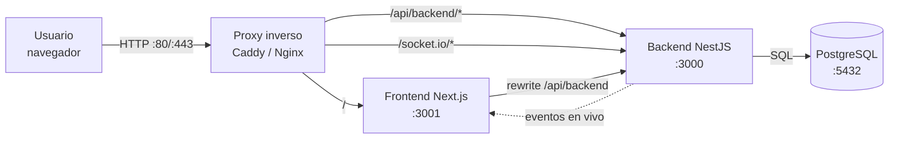

# RestorApp — Documentación técnica

Sistema integral de gestión para restaurantes: pedidos, mesas, cocina, caja,
facturación, inventario, compras, reportes y usuarios en tiempo real.

Esta carpeta documenta **cómo funciona el sistema real**, no un ideal. Todo lo
descrito aquí fue extraído del código fuente, de la migración de base de datos y
de pruebas ejecutadas sobre la aplicación.

- **Versión documentada:** estado del repositorio al 2026-11-06
- **Backend:** NestJS 11 + TypeORM + PostgreSQL
- **Frontend:** Next.js 14 (App Router) + React 18 + Tailwind
- **Tiempo real:** Socket.io 4
- **Autenticación:** JWT RS256 en cookie httpOnly

---

## Índice

| # | Documento | Para qué sirve |
|---|---|---|
| 01 | [Arquitectura general](01-arquitectura-general.md) | Cómo está armado el sistema y cómo viaja una petición |
| 02 | [Backend](02-backend.md) | Módulos, capas, seguridad, validación, eventos, cron |
| 03 | [Frontend](03-frontend.md) | Rutas, componentes, sesión, llamadas a la API, tiempo real |
| 04 | [Base de datos](04-base-de-datos.md) | Tablas, relaciones, índices, migraciones, respaldos |
| 05 | [Referencia de la API](05-api-referencia.md) | Todos los endpoints, permisos y ejemplos |
| 06 | [Permisos y roles](06-permisos-y-roles.md) | Qué puede hacer cada rol y cómo se aplica |
| 07 | [Flujos de negocio](07-flujos-de-negocio.md) | Pedido, cocina, cobro, caja, inventario, compras |
| 08 | [Tiempo real (Socket.io)](08-tiempo-real-socket.md) | Eventos, salas, autenticación y reconexión |
| 09 | [Configuración y entornos](09-configuracion-entornos.md) | Todas las variables, desarrollo y producción |
| 10 | [Despliegue seguro](10-despliegue-seguro.md) | Instalar en otra máquina, proxy, HTTPS, checklist |
| 11 | [Operación y mantenimiento](11-operacion-y-mantenimiento.md) | Logs, salud, respaldos, migraciones, diagnóstico |
| 12 | [Seguridad](12-seguridad.md) | Controles implementados y riesgos pendientes |
| 13 | [Pruebas y calidad](13-pruebas-y-calidad.md) | Tests, lint, compilación y verificación |
| 14 | [Licencia y créditos](14-licencia-y-creditos.md) | Modelo legal, MIT del backend base y atribuciones |

---

## Mapa general del sistema

En **desarrollo** no hay proxy: el navegador abre el frontend en `:3001` y Next
reenvía `/api/backend/*` al backend en `:3000`. En **producción** se recomienda
un solo origen con proxy para eliminar CORS y compartir host entre la cookie y
el socket.

---

## Cómo leer esta documentación

1. Si vas a **instalar** el sistema: empieza por `10-despliegue-seguro.md`.
2. Si vas a **programar**: `01-arquitectura-general.md`, `02-backend.md`,
   `03-frontend.md` y `04-base-de-datos.md`.
3. Si vas a **consumir la API**: `05-api-referencia.md` y
   `06-permisos-y-roles.md`.
4. Si vas a **operar** el sistema: `11-operacion-y-mantenimiento.md` y
   `12-seguridad.md`.

## Diagramas

La documentación incluye **29 diagramas Mermaid** en español (arquitectura,
secuencias, estados, flujos y entidad-relación). Todos fueron validados con el
parser oficial de Mermaid: **0 errores de sintaxis**.

Para verlos:

- En GitHub, GitLab o VS Code (extensión Markdown Preview Mermaid) se renderizan
  automáticamente.
- En un visor que no soporte Mermaid, verás el código del diagrama; puedes
  pegarlo en <https://mermaid.live> para visualizarlo.

## Convenciones

- **Monto:** siempre en pesos colombianos (COP), dos decimales.
- **Fechas:** el backend guarda `timestamptz`; el negocio calcula el día en
  zona `America/Bogota`.
- **Roles globales:** `Administrador`, `Mesero`, `Chef`, `Cajero`.
- **Roles de turno:** `mesero`, `cajero`, `cocinero` (asignación operativa).
- **Estados de pedido:** `pendiente`, `en_preparacion`, `listo`, `entregado`,
  `cancelado`.
- **Estados de factura:** `pendiente`, `pagado`, `anulado`.
- **Estados de turno:** `abierto`, `cerrado`.

## Glosario

| Término | Significado |
|---|---|
| **Turno** | Período de caja abierta. Solo puede existir uno abierto a la vez. |
| **Arqueo** | Comparación entre el efectivo esperado y el contado al cerrar caja. |
| **Línea** | Un ítem dentro de un pedido (producto + cantidad + estado). |
| **Receta** | Lista de ingredientes y cantidades que consume un plato. |
| **Reserva de stock** | Stock apartado para un pedido aún no entregado. |
| **CUFE / DIAN** | Facturación electrónica colombiana. **No implementada** en esta versión. |
| **Cobro propio** | El mesero cobra desde Pedidos (`modo: "propio"`). |
| **Cobro en caja** | El pedido queda pendiente y el cajero cobra en Facturación. |

## Fuente de verdad

El código manda. Si esta documentación y el código difieren, revisa primero:

- Rutas y permisos: `prime-nestjs/src/**/*.controller.ts`
- Reglas de negocio: `prime-nestjs/src/**/*.service.ts`
- Esquema: `prime-nestjs/src/migrations/`
- Pantallas: `restorapp-nextjs/src/app/`
- Configuración: `.env` / `.env.example` de cada proyecto

## Estado general (resumen)

| Aspecto | Estado |
|---|---|
| Funcionalidad | Operativa y probada en red local |
| Backend | 25 pruebas unitarias en verde |
| Lint backend | Sin errores |
| Build frontend | Correcto |
| Tiempo real | Verificado en `localhost` y en IP de LAN |
| Base de datos | `synchronize: false`, migraciones versionadas |
| Facturación electrónica DIAN | **No implementada** |
| HTTPS | No configurado por defecto (ver documento 10) |
| Cuentas demo | Activas; se pueden desactivar con `npm run security:demo-off` |
