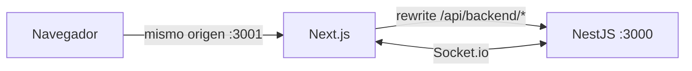

<p align="center">
  
</p>

<h1 align="center">RestorApp Web</h1>

<p align="center">
  Interfaz web de RestorApp<br>
  Next.js 14 · React 18 · TypeScript · Tailwind CSS · Socket.io
</p>

<p align="center">
  
  
  
  
  
  
</p>

---

## ¿Qué es?

Frontend de RestorApp, el sistema de gestión para restaurantes. Consume la API
REST del backend y mantiene las pantallas sincronizadas por Socket.io.

Incluye las pantallas de salón, pedidos, cocina, caja, facturación, carta,
inventario, proveedores, usuarios, reportes y configuración.

> Este frontend es **desarrollo original de RestorApp**. No deriva del proyecto
> `prime-nestjs`; solo el backend se construyó a partir de ese proyecto base.

La documentación técnica completa está en
[`../documentacion/`](../documentacion/README.md). El backend vive en
[`../prime-nestjs/`](../prime-nestjs/README.md).

---

## Requisitos

| Requisito | Versión |
|---|---|
| Node.js | 20 o superior |
| npm | 10 o superior |
| Backend de RestorApp | Corriendo y accesible |

---

## Instalación

```bash
cd restorapp-nextjs
npm ci --ignore-scripts
cp .env.example .env
npm run dev
```

La aplicación queda en `http://localhost:3001`.

Para producción:

```bash
npm run build
npm run start
```

> Detén `next dev` antes de ejecutar `next build`. En Next 14 ambos comparten
> la carpeta `.next` y pueden interferir entre sí.

---

## Variables de entorno

Plantilla: [`.env.example`](.env.example). Referencia completa:
[`../documentacion/09-configuracion-entornos.md`](../documentacion/09-configuracion-entornos.md).

| Variable | Para qué sirve |
|---|---|
| `API_URL` | URL que usa el servidor de Next para hablar con NestJS. En producción detrás de proxy: `http://127.0.0.1:3000`. |
| `NEXT_PUBLIC_API_URL` | URL del backend para el navegador (Socket.io). Vacío = mismo origen. |
| `NEXT_PUBLIC_SOCKET_SAME_ORIGIN` | `true` detrás de Nginx/Caddy para usar el mismo origen. |
| `COOKIE_SECURE` | `true` solo si el sitio se sirve por HTTPS. |

Modos de uso:

- **Desarrollo**: `API_URL=http://127.0.0.1:3000`,
  `NEXT_PUBLIC_API_URL=http://localhost:3000`,
  `NEXT_PUBLIC_SOCKET_SAME_ORIGIN=false`, `COOKIE_SECURE=false`.
- **Producción con proxy**: `API_URL=http://127.0.0.1:3000`,
  `NEXT_PUBLIC_API_URL=` (vacío), `NEXT_PUBLIC_SOCKET_SAME_ORIGIN=true`.

No subas `.env` al repositorio.

---

## Scripts

| Script | Qué hace |
|---|---|
| `npm run dev` | Desarrollo con recarga en el puerto `3001` |
| `npm run build` | Compila para producción |
| `npm run start` | Sirve el build en el puerto `3001` |
| `npm run lint` | ESLint (`next lint`) |

---

## Rutas de la aplicación

| Ruta | Pantalla |
|---|---|
| `/` | Redirige a `/login` |
| `/login` | Inicio de sesión |
| `/dashboard` | Resumen del día |
| `/dashboard/carta` | Carta, categorías, ingredientes y recetas |
| `/dashboard/mesas` | Mapa y estado de mesas |
| `/dashboard/cocina` | Cola de preparación en vivo |
| `/dashboard/pedidos` | Crear pedidos, agregar líneas y cobrar |
| `/dashboard/facturacion` | Cobro, pago mixto y anulación |
| `/dashboard/caja` | Apertura, movimientos y cierre de turno |
| `/dashboard/caja/cierre/[id]` | Detalle del arqueo |
| `/dashboard/inventario` | Stock, recetas y movimientos |
| `/dashboard/proveedores` | Proveedores |
| `/dashboard/usuarios` | Usuarios y roles |
| `/dashboard/reportes` | Lista de reportes |
| `/dashboard/reportes/[id]` | Reporte, PDF y CSV |
| `/dashboard/configuracion` | Ajustes |

### Rutas internas de Next

| Ruta | Método | Función |
|---|---|---|
| `/api/auth/login` | POST | Llama a `POST /auth/login` del backend y crea la cookie `token` |
| `/api/auth/logout` | POST | Borra las cookies de sesión |

---

## Cómo se conecta con la API



- `next.config.js` reescribe `/api/backend/:path*` hacia `API_URL`.
- Las pantallas llaman a `/api/backend/...`; el navegador nunca necesita CORS.
- La cookie de sesión es `httpOnly`, `sameSite=strict`, con 8 horas de vida.
- `middleware.ts` protege `/dashboard/**`: sin cookie `token` redirige a
  `/login?redirect=...`.
- El cliente de Socket.io usa el host de la página y conserva el protocolo y el
  puerto configurados, para que la cookie viaje correctamente aunque cambie la
  IP del servidor.

Detalle completo en
[`../documentacion/03-frontend.md`](../documentacion/03-frontend.md) y
[`../documentacion/08-tiempo-real-socket.md`](../documentacion/08-tiempo-real-socket.md).

---

## Estructura

```text
restorapp-nextjs/
├── src/
│   ├── app/
│   │   ├── layout.tsx        Layout raíz
│   │   ├── page.tsx          Redirección inicial
│   │   ├── login/            Acceso
│   │   ├── api/auth/         Login y logout (cookie)
│   │   └── dashboard/        Pantallas internas
│   ├── components/           Componentes reutilizables
│   ├── lib/                  API, socket, formatos, reportes
│   └── middleware.ts         Protección de rutas
├── public/                   Recursos estáticos
├── next.config.js            Rewrite hacia el backend
├── tailwind.config.ts
└── .env.example
```

---

## Calidad

```bash
npx next lint
npm run build
```

El estado de la última verificación está en
[`../documentacion/13-pruebas-y-calidad.md`](../documentacion/13-pruebas-y-calidad.md).

---

## Licencia

**RestorApp Web es software propietario.** © 2026 Daniel Rojas (@dsrojasal). Todos los
derechos reservados.

Este frontend es desarrollo original y **no** deriva de `prime-nestjs`. Las
dependencias de npm conservan sus propias licencias.

- [`LICENSE`](LICENSE) — licencia propietaria del frontend.
- [`../LICENSE`](../LICENSE) — licencia propietaria del proyecto completo.
- [`../THIRD_PARTY_NOTICES.md`](../THIRD_PARTY_NOTICES.md) — avisos de terceros
  (aplican al backend, no a este frontend).

---

<p align="center">
  <a href="../README.md">← Volver al README principal</a>
</p>
